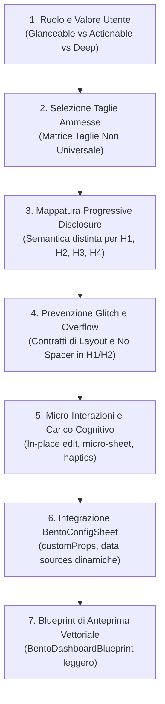

# Guida Definitiva: Filosofia, Architettura e Guida Dimensionale per i Widget Bento di Solducci

> **Destinatari:** Agenti software autonomi, ingegneri UI/UX e sviluppatori incaricati di progettare, estendere o refattorizzare widget per l'ecosistema Bento di **Solducci**.  
> **Stato:** Documento Guida Normativo e Operativo  
> **Fonti Storiche:** `bento_grid_v2_master_specification.md`, `bento_grid_and_widgets_v2_study.md`, `DESIGN_GUIDELINES.md`, conversazione `7330aeb1`.

---

## 1. La Visione Fondativa: La Dashboard come Scrivania Operativa ("Life OS")

In Solducci, la Bento Home non è una bacheca passiva di statistiche né un aggregatore di link ipertestuali. È una **scrivania fisica interattiva** su cui l'utente organizza e vive la propria quotidianità finanziaria ed esistenziale.

Quando progetti un nuovo widget, devi sempre rispettare **cinque pilastri filosofici non negoziabili**:

```
┌────────────────────────────────────────────────────────────────────────┐
│                   I 5 PILASTRI DEI WIDGET SOLDUCCI                     │
├────────────────────────────────────────────────────────────────────────┤
│ 1. CONTINUITÀ COGNITIVA (Zero Disruptive Routing)                     │
│    Mai allontanare l'utente dalla dashboard per micro-azioni.          │
│    Input, spunte e modifiche avvengono in-place o su micro-sheet.      │
├────────────────────────────────────────────────────────────────────────┤
│ 2. AFFORDANCE DINAMICA ED ECONOMIA VISIVA                             │
│    Se un glifo, un'animazione o un colore spiegano l'azione, elimina   │
│    ogni testo didascalico ("Da/A", "Inverti", "+ Cartella").           │
├────────────────────────────────────────────────────────────────────────┤
│ 3. NEUTRALITÀ ASSOLUTA DEI DATI (Zero Mock Arbitrari)                  │
│    Mai valori preimpostati fittizi (es. 100€). Usa placeholder neutri  │
│    ("__") e connettiti sempre a stream di dati reali.                  │
├────────────────────────────────────────────────────────────────────────┤
│ 4. PROGRESSIVE DISCLOSURE SEMANTICA                                    │
│    Aumentare la taglia non significa ingrandire i caratteri: significa │
│    aggiungere un livello semantico di informazione o di azione.        │
├────────────────────────────────────────────────────────────────────────┤
│ 5. RIGIDA GESTURE ARENA (Primato dello Scroll Verticale)               │
│    Lo scorrimento della pagina vince sempre. Le interazioni orizzontali│
│    interne richiedono dead-zone (>15px). Disattivazione in Edit Mode.  │
└────────────────────────────────────────────────────────────────────────┘
```

---

## 2. Il Sistema Geometrico Bento v2: Scala Matematico-Dimensionale

La Bento Grid adotta una griglia mobile-first su **4 colonne logiche** (calcolata su viewport standard smartphone di ~390px con padding laterale e gap tra le celle di 16px).

### 2.1 La Conversione Dimensionale v2
La revisione dimensionale v2 ha standardizzato la cella verticale applicando un fattore $\times 0.75$ rispetto alla colonna orizzontale. La larghezza della colonna base è $W \approx 77.5\text{px}$, mentre la nuova unità di riga verticale base è $H_1 \approx 54\text{px}$.

```
Scala v2 delle Altezze (Vertical Tiers):
+---------------------------------------------------------------+
| H1 (~54px, factor 0.75):  MINI-BANNER & AZIONE PUNTIFORME     |
+---------------------------------------------------------------+
| H2 (~124px, factor 1.50): BANNER COMPATTO / BOTTONE ATTIVO    |
+---------------------------------------------------------------+
| H3 (~194px, factor 2.25): DUE LIVELLI A CONFRONTO (MACRO/MIC) |
+---------------------------------------------------------------+
| H4 (~265px, factor 3.00): RISORSA DENSA / LISTA VIRTUALIZZATA |
+---------------------------------------------------------------+
```

### 2.2 Tassonomia Funzionale per Altezza

| Livello di Altezza | Altezza Netta | Taglie Tipiche | Ruolo Semantico & Filosofia UX | Esempi Reali di Riferimento |
| :--- | :---: | :---: | :--- | :--- |
| **Altezza 1 ($H_1$)** | **~54px** | `2x1`, `4x1` | **Mini-Banner & Azione Puntiforme Diretta:**<br>Un singolo indicatore glanceable, una pill di saldo compatto, un input di testo a riga singola (cattura rapida) o un trigger di trasferimento immediato a tocco singolo. | • `quick_transfer` 2x1 (sposta 50€)<br>• `quick_scratchpad` 2x1 (input al volo)<br>• `balance` 2x1 (pill orizzontale) |
| **Altezza 2 ($H_2$)** | **~124px** | `2x2`, `4x2` | **Banner Informativo / Bottone Arricchito Attivo:**<br>Dato cardine + 2 metriche correlate, oppure 2 card orizzontali dense senza scroll, o micro-interazione circolare con feedback aptico immediato. | • `habit_tracker` 2x2 (cerchi touch 🔥)<br>• `category_expenses` 2x2 (top 2 schede)<br>• `monthly_burn_rate` 2x2 (gauge + %) |
| **Altezza 3 ($H_3$)** | **~194px** | `2x3` | **Layout Informativo a Due Livelli a Confronto:**<br>Suddivisione tassativa in due sezioni semantiche:<br>1. *Superiore (~70px):* Visione Macroscopica / Sintesi (totale, indice, delta %);<br>2. *Inferiore (~95px):* Visione Microscopica o Azione (sparkline 7 giorni, voci urgenti con quick-action "Paga/Spunta" a un tocco). | • `monthly_burn_rate` 2x3 (spesa vs sparkline budget 7gg)<br>• `cashflow_forecast` 2x3 (saldo futuro vs timeline scadenze)<br>• `recurring_movements` 2x3 (totale fisso vs CTA "Paga") |
| **Altezza 4 ($H_4$)** | **~265px** | `2x4`, `3x4`, `4x4` | **Risorsa Densa / Lista Completa Virtualizzata:**<br>Collezione estesa operativa. Header con switcher e filtri, corpo virtualizzato scrollabile e dock comandi inferiore con riga di inserimento compatto "in miniatura". | • `focus_tasks` 2x4 (lista task con swipe)<br>• `shopping_quick_list` 2x4 (spesa)<br>• `notes_explorer` 2x4 (cartelle e note)<br>• `note_stack` 2x4 (mazzo 3D) |

---

### 2.3 Formati Speciali: Taglia 1x1 e Layout Panoramici (4x2)

#### Taglia 1x1 (~75x75px) — Tile Simbolico a Tocco Integrale
- **Regola Aurea:** In un quadrato così compatto, un'icona interna di espansione (es. `open_in_full` di 21px) ruberebbe oltre il 40% dello spazio utile, soffocando il valore.
- **Implementazione Obbligatoria:**
  1. *Nessun pulsante interno:* nascondere decorazioni e icone secondarie;
  2. *Tocco Integrale:* l'intera superficie della card agisce da tap target per navigare alla vista dedicata (`onTap: onExpand`);
  3. *Layout Pulito:* Icona del servizio con glow neon centrata in alto + valore numerico o badge sintetico in basso.

#### Taglie Panoramiche 4x1 e 4x2 — Struttura Asimmetrica a Due Colonne
Quando un widget si espande a tutta larghezza (4 colonne, larghezza netta ~358px):
- **Vietato:** allungare banalmente un testo o una barra a tutto schermo creando spazi deserti.
- **Obbligatorio: Struttura a Due Colonne Asimmetriche (es. 35%/65% o 45%/55%):**
  - **Colonna Sinistra (Analitica / Visuale):** Grafico sintetico a ciambella (Donut), gauge tachimetro, oppure pill navigatore dello stack con contatore;
  - **Colonna Destra (Dettaglio Operativo):** Matrice di categorie 2x2, tabella weekly heatmap a 7 giorni, anteprima testo estesa con pulsanti di azione.

---

## 3. Metodologia di Ideazione di un Nuovo Widget (Step-by-Step per Agenti)

Quando ricevi l'incarico di ideare o implementare un nuovo widget, segui questa procedura in 7 passi:



---

### Passo 1: Definizione del Ruolo Semantico
Stabilisci a quale famiglia appartiene il widget:
- **Glanceable (Monitoraggio Rapido):** comunica un parametro vitale in meno di un secondo (es. Burn Rate, Saldo, Proiezione Cashflow).
- **Actionable (Innesco Operativo Rapido):** riduce a un tocco un'azione frequente (es. Giroconto 50€, Quick Expense, Spunta Routine odierna).
- **Deep Resource (Scrivania di Contenuti):** gestisce elenchi dinamici e gerarchici (es. Note Sticky, Focus Tasks, Shopping List).

### Passo 2: Selezione delle Taglie (Non Progettare Taglie Inutili!)
**Non tutti i widget devono supportare tutte le taglie.**
- Un widget per un singolo bonifico rapido non ha senso in `2x4` (diventerebbe solo spazio vuoto sprecato).
- Una lista complessa di note non può esistere in `2x1` (non avrebbe spazio per mostrare alcun contenuto).
- Assegna al widget solo le 2 o 3 taglie in cui esprime un valore reale.

### Passo 3: Mappatura del Progressive Disclosure
Compila sempre prima di scrivere codice la matrice di transizione:

```
┌──────────┬─────────────────────────────────────────────────────────────┐
│ TAGLIA   │ COSA MOSTRA E COSA PERMETTE DI FARE                         │
├──────────┼─────────────────────────────────────────────────────────────┤
│ In 2x1   │ [Dato A] + Azione one-tap                                   │
│ In 2x2   │ [Dato A] + [Dato B correlato] + Toggle interattivo con aptico│
│ In 2x3   │ Livello 1 (Macro) vs Livello 2 (Micro/Sparkline/Quick CTA)  │
│ In 2x4   │ Lista virtualizzata con scroll + riga inline "in miniatura" │
│ In 4x2   │ Split orizzontale asimmetrico: Grafico (sx) + Dettaglio (dx)│
└──────────┴─────────────────────────────────────────────────────────────┘
```

---

### Passo 4: Regole Auree di Layout per Evitare Glitch e Overflow (`RenderFlex`)

Dagli incidenti di layout storici documentati nella conversazione (overflow di 5px e 28px), sono state estratte le seguenti regole ingegneristiche categoriche:

1. **Divieto di `Spacer()` non vincolati su H1 e H2:**
   - In altezze ristrette (54px e 124px), l'uso di `Spacer()` tra elementi a dimensione intrinseca genera quasi sempre un overflow di pochi pixel.
   - **Soluzione:** Utilizzare `Column` o `Row` con `mainAxisAlignment: MainAxisAlignment.spaceBetween`, specificando padding espliciti e ridotti (es. 8px o 12px, mai 24px).
2. **Nessun `width: double.infinity` in Flex orizzontali:**
   - Nei contenitori di anteprima o nelle card affiancate, forzare larghezza infinita manda in crash il motore di layout di Flutter.
   - Usare `Expanded`, `Flexible` o vincolare con `BoxConstraints`.
3. **Auto-Dimensionamento dei Numeri e Testi a Rischio:**
   - Se un importo o un valore può raggiungere molte cifre (es. transazioni a 4-5 cifre), avvolgerlo con `FittedBox(fit: BoxFit.scaleDown)` affinché il font scali automaticamente verso il basso anziché andare a capo su più righe e spingere i pulsanti d'azione al di fuori dell'area visibile.
4. **I Nomi dei Conti e delle Entità Possono Andare a Capo:**
   - Nomi di istituti bancari o categorie non devono essere tagliati con puntini (`...`) se lo spazio orizzontale è stretto: consentire `maxLines: 2` con line-height compatto.

---

### Passo 5: Progettazione delle Micro-Interazioni e Feedback Fisico

- **In-Place Editing:** Toccando il corpo di una nota o un campo rapido, la card si trasforma sul posto in input attivo, senza cambiare pagina.
- **Feedback Aptico:** Ogni azione transazionale (spuntare una routine, eseguire un giroconto, completare un task) deve invocare `HapticFeedback.lightImpact()` o `mediumImpact()`.
- **Micro-Animazioni Transizionali:** Utilizzare `flutter_animate` per transizioni brevi (200-300ms, curve elastiche o `Curves.easeOutCubic`).
- **Indicatori Interattivi:** Badge come `(1/6)` o contatori non sono etichette passive: sono bottoni interattivi che aprono modali contestuali di selezione rapida e ricerca.

---

### Passo 6: Integrazione con il Motore di Configurazione (`BentoConfigSheet`)

Ogni widget deve supportare la persistenza dello stato tramite `customProps: Map<String, dynamic>?`:
- `targetId`: ID dell'entità collegata (es. `walletId`, `documentId`, `routineId`).
- `targetType`: tipo di sorgente (`"wallet"`, `"todo_list"`, `"shopping"`, ecc.).
- `titleOverride`: titolo personalizzato digitato dall'utente (es. *"Fondo Vacanze"* invece di *"Saldo"*).
- `selectedSources`: array di sorgenti multiple quando il widget supporta lo swipe tra liste diverse.

### Passo 7: Blueprint di Anteprima (Mai Montare Widget Vivi nelle Gallerie)
Nella galleria widget e nei preset della dashboard:
- **Vietato:** Istanziare la classe reale del widget all'interno delle card di catalogo.
- **Obbligatorio:** Agganciare il widget a [`BentoDashboardBlueprint`](file:///C:/Users/Aless/Documents/Projects/Solducci/lib/widgets/dashboard/gallery/bento_dashboard_blueprint.dart), definendo una rappresentazione grafica scalata con colori vettoriali e icone simboliche.

---

## 4. Master Catalog dei Widget Esistenti: Matrice delle Taglie

La seguente tabella rappresenta la specifica consolidata per il catalogo ufficiale dei 20 widget Bento di Solducci:

| Widget ID | Nome Funzionale | H1 (2x1) | H2 (2x2) | H3 (2x3) | H4 (2x4 / 3x4) | Panoramico (4x1 / 4x2) | Focus Semantico & Caratteristiche Speciali |
| :--- | :--- | :---: | :---: | :---: | :---: | :---: | :--- |
| `balance` | Saldo & Conti | ✅ | ✅ | ✅ *(Macro/Micro)* | - | `4x1` | Saldo consolidato, delta entrate/uscite, confronto netto debiti/crediti in gruppo. |
| `quick_expense` | Spesa Rapida | `4x1` | ✅ *(4 Chip)* | - | `2x4`, `3x4` | - | Tastierino touch integrato o chip a importo fisso; zero transizioni di rotta. |
| `quick_transfer` | Giroconto | ✅ *(One-tap)* | ✅ *(Chip "__")* | - | - | - | Freccia rotante interattiva a 180°, rimozione Da/A, chip d'importo neutra. |
| `monthly_burn_rate` | Burn Rate & Budget | - | ✅ | ✅ *(2 Livelli)* | - | `4x2` *(Split)* | Tachimetro spesa mensile, daily allowance consigliata e sparkline 7 giorni. |
| `category_expenses` | Spese per Categoria | ✅ | ✅ *(2 Schede)* | ✅ *(Confronto)*| `2x4` | `4x2` *(Donut+Grid)*| Top categorie con barre di avanzamento neon e distribuzione percentuale. |
| `recurring_movements`| Spese Ricorrenti | ✅ | ✅ | ✅ *(CTA Paga)* | ✅ *(Lista)* | `4x1` | Scadenze fisse imminenti con pulsante one-tap per saldare al volo. |
| `cashflow_forecast` | Liquidità 7 Giorni | - | - | ✅ *(2 Livelli)* | - | `4x2` *(Grafico+List)*| Saldo stimato a +7 giorni, indicatore semaforico e timeline scadenze. |
| `habit_tracker` | Routine & Abitudini | - | ✅ *(Touch 🔥)*| ✅ *(Anello %)* | - | `4x2` *(Heatmap)* | Completamento abitudini con tocco diretto e visualizzazione matrice settimanale. |
| `note_stack` | Mazzo Note 3D | - | - | ✅ *(Deck 3D)* | ✅ *(Deep Deck)*| `4x2` *(Split 1/3)* | Sfoglia note con swipe orizzontale 3D; edit in-place; trigger lista su `(1/N)`. |
| `recent_notes` | Note Recenti | - | ✅ *(Top 2)* | - | ✅ *(Virtual)* | - | Hub multi-nota compatto con riga inline in prima posizione per cattura rapida. |
| `notes_explorer` | Esploratore Note | - | - | - | ✅ *(Auto-Close)*| - | Navigazione cartelle e note: auto-chiusura del tab cartelle al tocco in 2x4. |
| `focus_tasks` | Task Urgenti | - | ✅ *(Top 2)* | - | ✅ *(Swipeable)*| - | Spunta task immediata con feedback aptico; switcher liste su swipe header. |
| `shopping_quick_list`| Lista della Spesa | - | ✅ *(Top 2)* | - | ✅ *(Inline Input)*| - | Lookup prodotti dispensa in background; aggiunta rapida inline con `(+)`. |
| `quick_scratchpad` | Cattura Istantanea | ✅ *(Text Input)*| ✅ *(Box 3 righe)*| - | - | - | Cattura universale di pensieri verso Asterischi o Note senza perdere il focus. |
| `unresolved_asterisks`| Asterischi / Inbox | ✅ | ✅ | - | ✅ | - | Raccoglitore di elementi da chiarire; navigazione orizzontale tra liste. |
| `hero_countdown` | Scenari Temporali | `2x1` | ✅ | - | - | `4x1` | Conto alla rovescia eventi con sfondo glassmorphism e indicatore compatto. |

---

## 5. Checklist di Validazione per Nuovi Widget (Definition of Done)

Prima di considerare concluso lo sviluppo di un nuovo widget Bento, verifica punto per punto:

- [ ] **Dimensioni Appropriate:** Il widget supporta solo taglie in cui ha senso e implementa la filosofia semantica corrispondente ($H_1, H_2, H_3$ o $H_4$).
- [ ] **No Spacer Pericolosi:** In H1 e H2 non ci sono `Spacer()` non vincolati; il layout usa `MainAxisAlignment.spaceBetween` con padding calibrati.
- [ ] **Auto-Sizing:** Tutti i testi numerici e gli importi scalano (`FittedBox`) per non spingere bottoni d'azione fuori dalla vista.
- [ ] **Affordance Intrinseca:** Rimossa ogni etichetta testuale superflua ("Da", "A", "Inverti") sostituita da affordance visiva o animata.
- [ ] **Neutralità dei Dati:** Nessun valore pre-popolato fittizio (`100€`); placeholder neutri (`"__"`).
- [ ] **Isolamento delle Gesture:** Lo scroll verticale è ceduto al genitore; le gesture orizzontali interne hanno soglia minima di attivazione (>15px).
- [ ] **Zero Routing Disruptivo:** Le azioni brevi si compiono in-place o con micro-sheet; nessun `context.pushNamed` a pieno schermo per task atomici.
- [ ] **Dati Reali e Reattività:** Il widget legge `customProps`, si sottoscrive allo stream del servizio e mostra uno skeleton loader durante il fetch.
- [ ] **Multi-Contesto:** Se invocato in una vista aggregata (`isView`), la creazione rapida intercetta l'azione aprendo `ViewGroupPickerSheet`.
- [ ] **Blueprint Registrato:** Il widget possiede una rappresentazione vettoriale blueprint in `BentoDashboardBlueprint` per la galleria dei preset.
