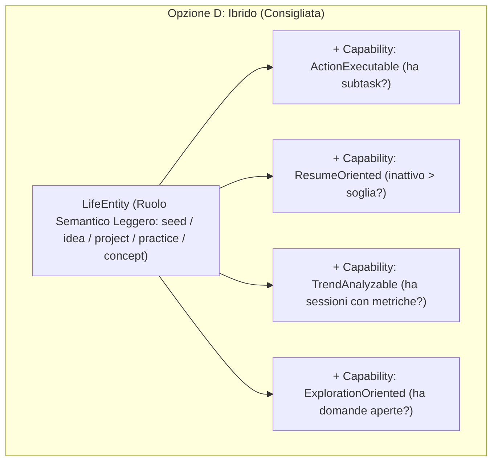
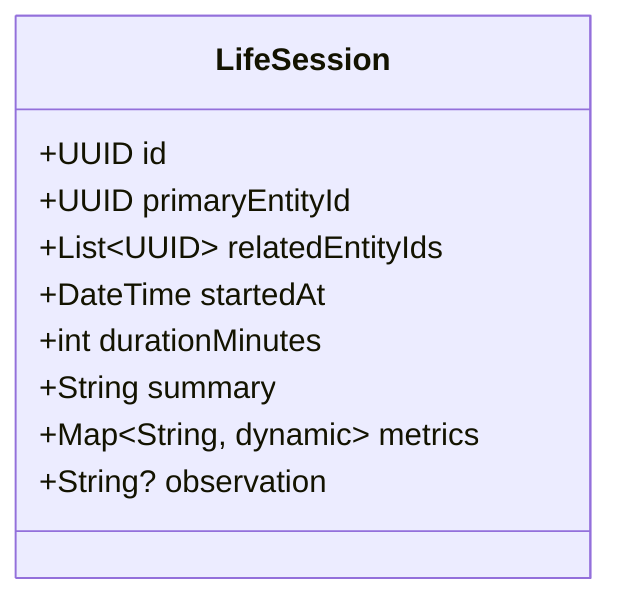
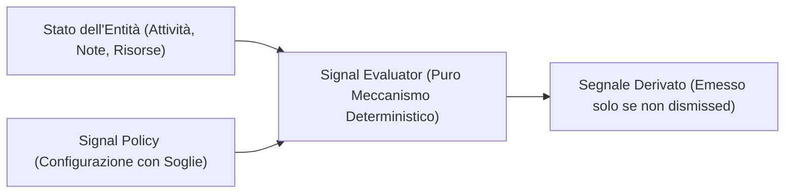
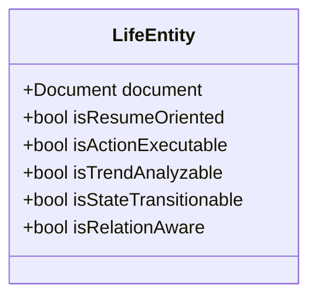

# Integration Design Challenge v0.1 — Minimum Commitment Architecture per il Living Core

> **Data:** 24 Ottobre 2026  
> **Autore:** Antigravity (Pair Programming con l'Autore)  
> **Contesto:** Progetto Solducci — Branch / Worktree `LIFE_OS`  
> **Scopo:** Stress-test critico delle ipotesi di persistenza, ontologia, sessioni e relazioni prima di scrivere qualsiasi migrazione o codice.

---

## 1. Domain Model ≠ Persistence Model: Analisi Critica di `Document`

Nella *Integration Exploration v0.1* avevamo proposto di ancorare le `LifeEntity` alla tabella esistente `documents`. È fondamentale distinguere con rigore due affermazioni ontologiche:

### Ipotesi A: "`Document` è il modello di dominio naturale di una `LifeEntity`"
* **Vantaggi apparenti:** Coerenza sintattica immediata con la codebase esistente; nessun nuovo concetto Dart; riuso diretto di `DocumentService`.
* **Leakage concettuale (Grave):** Un *Documento* evoca nella mente e nel codice un contenitore di testo, un file, una pagina o una lista (es. `TodoDocument`, `ShoppingListDocument`). Ma nella vita reale un **Progetto** (es. *Solducci* o *Agrivoltaico*) è un'iniziativa orientata a uno scopo; una **Pratica** (es. *Speedcubing*) è un'abitudine di sviluppo abilità continuativa nel tempo; un **Concetto** (es. *GDPR*) è un'unità epistemica. Trattare una Pratica come una sottoclasse di `Document` violerebbe il principio di chiarezza semantica.
* **Vincoli futuri:** Qualsiasi operazione non documentale (es. calcolo del momentum, transizioni di stato di commitment, aggregazione di metriche temporali) risulterebbe un innesto forzato su una classe pensata per elenchi e note.
* **Costo di migrazione se l'ipotesi si rivela errata:** Altissimo. Disaccoppiare il dominio da `Document` dopo aver diffuso `Document` in tutta la UI LifeOS richiederebbe un refactoring massivo di viste, controller e bloc.

### Ipotesi B (Raccomandata): "`documents` è semplicemente un eccellente supporto tecnico di storage iniziale"
* **Vantaggi:** Separazione netta tra Dominio e Persistenza. Nel domain layer modelliamo `LifeEntity` come entità autonoma di business; nel repository layer utilizziamo la tabella Postgres `documents` (e la sua controparte locale Hive) come tabella di memorizzazione polimorfica flessibile, sfruttando i campi esistenti `id`, `user_id`, `group_id`, `title`, `description` e `metadata JSONB`.
* **Leakage concettuale:** Zero nel dominio. Il dominio non sa nemmeno che la tabella SQL si chiami `documents`; interagisce tramite un `LifeEntityRepository`.
* **Vincoli futuri:** Minimi. Se un domani LifeOS necessiterà di una tabella dedicata o di un database a grafo separato, cambierà solo l'implementazione del repository DAO, senza toccare una singola riga di logica di business o di UI.
* **Cosa succede con oggetti Solducci che NON sono documenti (es. Spese, Wallets, singoli Task):**  
  Invece di imporre Foreign Key rigide `REFERENCES documents(id)`, il modello adotta riferimenti polimorfici orientati (`target_type`, `target_id`), permettendo a una `LifeEntity` di collegarsi in modo nativo a una spesa o a un task senza doverli mascherare da documenti.

---

## 2. Natura di Idea / Project / Concept / Practice: Il Test delle 4 Opzioni

Stressiamo le 4 modalità di classificazione su 4 casi concreti: **Solducci**, **Agrivoltaico**, **Speedcubing**, **Crochet**.



| Opzione | Descrizione Meccanismo | Solducci (Software) | Agrivoltaico (Esplorativo) | Speedcubing (Pratica) | Crochet (Creazione) | Valutazione & Rischi |
| :--- | :--- | :--- | :--- | :--- | :--- | :--- |
| **A. Tipi Espliciti Rigidi** (`enum`) | `type = project \| idea \| concept \| practice` | Nasce Project. Funziona, ma irrigidisce la distinzione con le idee interne. | Forzato a scegliere: è Idea o Project? L'utente esita. | Classificato Practice. Blocca eventuali progetti temporanei (es. "Comprare nuovo cubo"). | Nasce Idea, ma quando diventa manufatto fisico lo schema deve mutare con migrazione. | **Rigida.** Viola `DP04 Progressive Structuring` e crea frizione alla cattura. |
| **B. Profili / Schemi** | Una Entity adotta collezioni di campi (`has_execution_schema`, ecc.) | Flessibile, ma richiede logica complessa per sapere quali schermate mostrare. | Funziona bene, ma aggiunge boilerplate di selezione schema. | Difficile capire se è una pratica o un progetto senza un tag primario. | Accumula schemi multipli disordinati. | **Sovrastrutturata.** Eccessiva complessità di gestione per una prima slice. |
| **C. Pura Capability** | Nessun tipo; tutto è dedotto (ha task? $\rightarrow$ è taskable) | La UI non sa se Solducci è un progetto o una lista della spesa finché non legge i task. | Se non ha task, la UI non sa come presentarlo (sembra un contenitore vuoto). | Le sessioni abilitano grafici, ma manca il concetto esplicito di "Disciplina/Hobby". | Nessun senso di "cosa sia" l'oggetto finché non accumula dati. | **A-semantica.** Disorienta l'utente: la mente umana ha bisogno di un'ancora concettuale (*"questo è un progetto"*, *"questa è un'idea"*). |
| **D. Ibrido (Raccomandato)** | **Ruolo semantico dichiarativo leggero (`role` string in metadata) + Capability dedotte da componenti presenti** | `role: 'project'`, task presenti $\rightarrow$ mostra Project Vitrine + Execution view. | `role: 'idea'`, domande aperte presenti $\rightarrow$ mostra Exploration view, zero task obbligatori. | `role: 'practice'`, metriche presenti $\rightarrow$ mostra Sparkline + Session Runner. | Nasce con `role: 'idea'`, matura, l'utente clicca *"Promuovi a Progetto"* (cambia solo il campo `role`). | **Ottimale.** Preserva l'intenzione umana senza bloccare la fluidità operativa. |

### Domanda centrale: cosa perdiamo se NON decidiamo oggi il tipo definitivo?
**Non perdiamo assolutamente nulla, e guadagniamo tutto.**  
Se memorizziamo il ruolo come un campo semantico descrittivo (`metadata['semantic_role'] = 'project' | 'idea' | 'practice' | 'concept'`) anziché come vincolo di schema relazionale rigido a livello di database:
1. L'utente può promuovere un'Idea a Progetto o declassare un Progetto a Idea archiviata semplicemente modificando una stringa nei metadati.
2. La UI legge il ruolo per dare l'accento visivo primario, ma usa le capability per abilitare le azioni concrete.
3. Se tra due mesi scopriamo che serve il tipo `Area` o `Asset`, non dobbiamo eseguire alcuna migrazione SQL distruttiva.

---

## 3. Challenge della Session: Single Owner vs Multi-Entity

Nella prima esplorazione avevamo ipotizzato `SessionRecord` legata a un singolo `document_id`. Questo approccio collassa davanti ai casi d'uso reali:

```text
Caso 1 (Dev): Sessione di 2 ore su [Solducci], ma focalizzata su [Context Manager] e vincolata da [GDPR].
Caso 2 (Cubing): Sessione di 30 min su [Speedcubing], allenando specificamente [F2L Lookahead].
Caso 3 (Cerimonia): Sessione di 45 min di Weekly Review che tocca 4 progetti diversi.
```

### Confronto delle Strategie di Sessione



1. **Single Owner Entity (`entity_id` 1:1):**  
   *Troppo restrittiva.* Obbliga a scegliere tra assegnare la sessione a Solducci o al Context Manager, perdendo la tracciabilità della conoscenza associata.
2. **Sessione come Entità Pura con Archi N:M (`session_entities` table):**  
   *Troppo complessa.* Richiede 2 tabelle, join pesanti su ogni query e una UI complessa per selezionare decine di relazioni anche quando si vuole solo registrare un quarto d'ora di codice.
3. **Primary Entity + Related Entities (Soluzione Ottimale a Basso Impegno):**  
   Ogni sessione ha **un contesto primario obbligatorio** (`primary_entity_id`) e **una lista opzionale di entità collegate** (`related_entity_ids UUID[]` o array JSONB):
   - Nel 90% dei casi l'utente seleziona solo l'entità principale (*"Sto programmando Solducci"*).
   - Se desidera, aggiunge 1 o 2 chip contestuali (*"F2L"*, *"GDPR"*).
   - Le query per la Vitrine di Solducci restano velocissime (`WHERE primary_entity_id = :id OR :id = ANY(related_entity_ids)`).

---

## 4. Challenge delle Relazioni: Connessione Oltre i Documenti

Life OS deve fungere da tessuto connettivo per l'intera vita dell'utente. In Solducci esistono già entità che non sono documenti:
- Un **Task** (riga nella tabella `tasks`).
- Una **Spesa** (riga nella tabella `expenses`, es. hosting server o acquisto lana per crochet).
- Uno **Scenario Temporale / Evento** (riga nella tabella `time_scenarios`).
- Una **Persona / Gruppo** (riga in `groups` o `profiles`).

Se la tabella `entity_relations` imponesse `FOREIGN KEY (target_id) REFERENCES documents(id)`, isolerebbe LifeOS dal resto dell'app.

### Strategia di Riferimento Polimorfico Orientato (Minimum Commitment)

```sql
CREATE TABLE IF NOT EXISTS entity_relations (
  id UUID PRIMARY KEY DEFAULT gen_random_uuid(),
  source_id UUID NOT NULL, -- Di norma l'ID della LifeEntity sorgente
  source_type TEXT NOT NULL DEFAULT 'entity',
  
  target_id UUID NOT NULL, -- ID dell'oggetto collegato
  target_type TEXT NOT NULL DEFAULT 'entity', -- 'entity', 'task', 'expense', 'time_scenario', 'external'
  
  relation_type TEXT NOT NULL, -- 'requires', 'influences', 'part_of', 'context_for', 'funded_by'
  context_status TEXT,         -- 'blocker', 'active', 'resolved', 'reference'
  metadata JSONB DEFAULT '{}'::jsonb,
  created_at TIMESTAMPTZ DEFAULT now()
);

CREATE INDEX IF NOT EXISTS idx_entity_relations_source ON entity_relations(source_id, source_type);
CREATE INDEX IF NOT EXISTS idx_entity_relations_target ON entity_relations(target_id, target_type);
```

#### Perché questa è la soluzione minima e scalabile:
1. **Nessun Graph Engine complesso:** È una tabella SQL normalizzata semplicissima, con indici B-Tree diretti.
2. **Connettività totale immediata:** Permette con zero modifiche future di collegare un Progetto a una Spesa reale (`target_type: 'expense'`), a un Task (`target_type: 'task'`) o a un Evento (`target_type: 'time_scenario'`).
3. **Stato contestuale nativo (`context_status`):** Supporta nativamente la regola per cui il GDPR non è un blocker globale, ma è un bloccante solo dentro la relazione con Solducci (`relation_type: 'requires'`, `context_status: 'blocker'`).

---

## 5. Meaningful Activity: Oltre il Falso Mito di `updatedAt`

Modificare una virgola nel titolo o riordinare una lista non è "progresso". Ritenere un progetto attivo solo perché un record è stato toccato dal DB produce un'illusione statistica.

### Definizione Operativa di "Attività Significativa"
Un'attività è considerata *significativa* per il momentum e per lo specchio dell'inattività se soddisfa almeno uno di questi criteri:
1. **Sessione Vissuta:** Registrazione di una `LifeSession` sull'entità (impegno deliberato di tempo).
2. **Transizione di Progresso:** Completamento o avanzamento di un task/milestone.
3. **Decisione / Punto Fermo:** Aggiunta o risoluzione di una decisione/domanda aperta.
4. **Distillazione:** Creazione di una nota di sintesi o estrazione di conoscenza.
5. **Check-in da Cerimonia:** Conferma esplicita di focus durante la cerimonia settimanale.

### Strategia di Derivazione vs Persistenza
- **Non memorizziamo una tabella di eventi ridondante.**
- Per garantire query istantanee sulla dashboard senza dover scansionare decine di tabelle con query aggregate pesanti, memorizziamo in `metadata` di `LifeEntity` un timestamp leggero:
  `metadata['last_meaningful_activity_at']`
- Questo campo viene aggiornato **esclusivamente** dai trigger applicativi delle 5 azioni sopra elencate. La semplice lettura o la modifica di un testo cosmetico aggiorna `updatedAt` del documento, ma **non** tocca `last_meaningful_activity_at`.

---

## 6. Signals: Separazione Rigorosa tra Meccanismo e Policy

Le soglie numeriche (es. *"14 giorni di inattività"*, *"3 note per considerare matura un'idea"*, *"5 risorse senza nota"*) non sono verità di dominio: sono **ipotesi di policy**, soggette a calibrazione empirica.

### Architettura Disaccoppiata



```dart
/// Configurazione di policy isolata e modificabile senza migrazioni DB
class MirrorSignalPolicy {
  final Duration inactivityWarningThreshold;
  final Duration inactivityDormantThreshold;
  final int ideaMaturityNotesCount;
  final int distillationDebtResourcesCount;

  const MirrorSignalPolicy({
    this.inactivityWarningThreshold = const Duration(days: 14),
    this.inactivityDormantThreshold = const Duration(days: 35),
    this.ideaMaturityNotesCount = 3,
    this.distillationDebtResourcesCount = 5,
  });
}
```

- **Silenziare il rumore (`Dismissibility`):** Ogni segnale può essere congedato dall'utente (*"Ignora per 30 giorni"*). L'azione scrive semplicemente `metadata['signals_snoozed'][signal_id] = expiryDate`.
- **Zero migrazioni:** Cambiare una soglia richiede la modifica di una riga di configurazione in Dart, senza toccare il database.

---

## 7. Tracciamento Reale della Strutturazione Progressiva (`DP04`)

Dimostriamo concretamente come il modello accoglie la crescita naturale senza conversioni forzate di schema:

### Caso 1: "Voglio fare un maglione oversize" (Crochet / Manufatto)
1. **Fase 1: Quick Capture (Giorno 1):**
   - Record creato in storage: `title: "Voglio fare un maglione oversize"`, `metadata: {'semantic_role': 'idea'}`.
   - UI: Compare come una semplice card nel blocco *"Idee in Incubazione"*. Nessun task richiesto, nessuna scadenza.
2. **Fase 2: Macerazione e Riferimenti (Settimana 3):**
   - L'utente salva 2 foto di modelli e una nota sul tipo di lana merino.
   - Record: `metadata['notes_count'] = 1`, collegate 2 risorse.
   - Il sistema non forza nulla; mostra solo il contenuto aggiunto.
3. **Fase 3: Promozione a Progetto Esecutivo (Settimana 6):**
   - L'utente decide di realizzarlo. Clicca *"Promuovi a Progetto"*.
   - Transizione: `metadata['semantic_role'] = 'project'`. Viene generata la Vitrine.
   - Aggiunge 3 task: [Comprare ferri circolari 8mm, Calcolare campionatura maglie, Avviare coste collo].
   - Collega una spesa: Relazione con la ricevuta del negozio di filati (`target_type: 'expense'`).

### Caso 2: "Agrivoltaico" (Esplorazione ad Alta Incertezza)
1. **Fase 1: Cattura (Giorno 1):**
   - `title: "Agrivoltaico"`, `metadata: {'semantic_role': 'idea', 'mode': 'exploration'}`.
2. **Fase 2: Raccolta Questioni e Documenti (Mese 2):**
   - Inserite domande aperte: *"Qual è la tariffa incentivante per impianti su terreni agricoli?"*, *"Quali vincoli paesaggistici nel comune X?"*.
   - Collegate 4 relazioni con documenti normativi e link istituzionali.
3. **Fase 3: Ibernazione Consapevole (Mese 4):**
   - Nessuna attività da 45 giorni.
   - Lo specchio segnala: *"Agrivoltaico è fermo da 45gg. Desideri mantenerlo parcheggiato o riattivarlo?"*. L'utente clicca *"Mantieni Parcheggiato"*.
   - Il progetto resta integro, con tutta la memoria delle domande aperte pronta per essere ripresa tra un anno.

### Caso 3: "Studiare meglio F2L" (Pratica / Maestria)
1. **Fase 1: Cattura (Giorno 1):**
   - `title: "Studiare meglio F2L"`, `metadata: {'semantic_role': 'practice'}`.
2. **Fase 2: Prime Sessioni di Pratica (Settimana 2):**
   - L'utente esegue una sessione: Durata 20 min. Metriche: `{"avg_50": 13.8, "worst": 18.2}`.
   - Osservazione qualitativa: *"Rallento vistosamente negli inserimenti posteriori quando il pezzo è orientato male"*.
3. **Fase 3: Operatività e Distillazione:**
   - La Vitrine mostra il trendline dei tempi.
   - Viene collegato l'algoritmo distillato: Relazione verso Concept `[F2L Algoritmi Posteriori]`.

---

## 8. Capability Architecture: Dal Concetto al Codice

Definiamo le 5 capability concrete del Living Core in termini di prerequisiti, regole di dominio, operazioni abilitate e collocazione nel codice:



### 1. `ResumeOriented`
- **Prerequisiti dati:** Entità con `semantic_role == 'project' | 'practice'` AND `last_meaningful_activity_at < now() - policy.inactivityThreshold`.
- **Regola di dominio:** Se un'entità con commitment è stata silente a lungo, la UI prioritaria deve essere la *Resume Surface*, non l'inbox operativo.
- **Operazione abilitata:** `buildResumeSummary()`, `reactivateEntity()`, `keepParked()`.
- **UI emergente:** Hero banner "Dove ti eri fermato" con ultima sessione, punti aperti e prossimo passo suggerito.
- **Collocazione codice:** Extension method su `LifeEntity` in `lib/features/life_os/domain/capabilities/resume_capability.dart`.

### 2. `ActionExecutable`
- **Prerequisiti dati:** Entità con task pendenti (`tasks.any((t) => !t.isCompleted)`).
- **Regola di dominio:** Un'entità non genera pressione esecutiva sul calendario a meno che non contenga esplicitamente item azionabili.
- **Operazione abilitata:** `getNextAction()`, `dispatchToWeeklyRails()`, `dispatchToTimeDial()`.
- **UI emergente:** Lista dei prossimi 3 task prioritari nella Vitrine e disponibilità nello slot del `TimeDialWidget`.
- **Collocazione codice:** `lib/features/life_os/domain/capabilities/actionable_capability.dart`.

### 3. `TrendAnalyzable`
- **Prerequisiti dati:** Entità con almeno 2 `LifeSession` aventi metriche numeriche strutturate omogenee in `metrics JSONB`.
- **Regola di dominio:** L'analisi quantitativa è abilitata solo dalla presenza effettiva di misurazioni comparabili.
- **Operazione abilitata:** `computeTrendLine()`, `getLatestMetricDelta()`.
- **UI emergente:** Grafico sparkline neon e delta rispetto alla media mobile.
- **Collocazione codice:** `lib/features/life_os/domain/capabilities/trend_capability.dart`.

### 4. `StateTransitionable`
- **Prerequisiti dati:** Entità con campo di ciclo di vita (`metadata['lifecycle_state'] = 'seed' | 'active' | 'paused' | 'completed'`).
- **Regola di dominio:** Ogni transizione di stato registra un timestamp e una motivazione facoltativa per la memoria storica.
- **Operazione abilitata:** `transitionTo(NewState, reason)`.
- **UI emergente:** Pulsanti di cambio stato contestuali con dialog rapido di riepilogo.
- **Collocazione codice:** `lib/features/life_os/domain/capabilities/state_transition_capability.dart`.

### 5. `RelationAware / ContextAware`
- **Prerequisiti dati:** Presenza di record in `entity_relations` che puntano o partono dall'entità.
- **Regola di dominio:** Mostra i vincoli attivi (es. blocker) prima dei semplici riferimenti informativi.
- **Operazione abilitata:** `getBlockers()`, `getDependencies()`, `getRelatedExpenses()`.
- **UI emergente:** Sezione "Ecosistema & Vincoli" nella Vitrine divisa tra Bloccanti e Riferimenti.
- **Collocazione codice:** `lib/features/life_os/domain/capabilities/relation_capability.dart`.

---

## 9. Minimum Commitment Architecture

Tavola delle decisioni architetturali per minimizzare il rischio di fossilizzazione precoce:

### 9.1 Decisioni Obbligatorie Prima del Codice (Required Before Coding)
1. **Adottare la separazione Dominio-Storage:** Il codice Dart espone `LifeEntity` e `LifeSession`, non classi intrise di gerarchie `Document`.
2. **Tabella SQL per le Relazioni Polimorfiche:** Creare `entity_relations` con `(source_id, source_type, target_id, target_type, relation_type, context_status)`.
3. **Tabella SQL per le Sessioni:** Creare `life_sessions` con `(primary_entity_id, related_entity_ids, started_at, duration_minutes, activity_summary, metrics, observations)`.
4. **Ruolo Semantico nei Metadati:** Memorizzare `semantic_role` in `metadata JSONB` di `documents` invece di creare un enum rigido Postgres.

### 9.2 Decisioni Sicure da Rinviare (Safe to Postpone)
1. *Ontologia definitiva di Goal vs Milestone vs Scenario:* Gestiti come semplici task o metadati finché l'esperienza sul campo non ne richiede la separazione.
2. *Algoritmi AI di riepilogo automatico:* Rimandati a quando avremo una base reale di sessioni e note registrate.
3. *Sincronizzazione esterna automatica (GitHub, Strava, cstimer):* Cattura manuale snella nella prima versione.

### 9.3 Scelte Implementative Reversibili (Reversible Implementation Choices)
1. Uso della tabella `documents` per lo storage: reversibile tramite il pattern Repository (`LifeEntityRepository`).
2. Calcolo dei segnali in memoria lato client: reversibile con cloud functions o viste materializzate in futuro.
3. Definizione delle soglie di policy in classi Dart costanti: reversibile con preferenze utente persistite in futuro.

### 9.4 Impegni Prematuri Pericolosi Evitati (Dangerous Premature Commitments AVOIDED)
- ❌ **Evitato:** Creare 4 tabelle SQL distinte per `projects`, `ideas`, `concepts`, `practices`.
- ❌ **Evitato:** Forzare una foreign key rigida tra relazioni e solo documenti (bloccando spese e task).
- ❌ **Evitato:** Creare un meta-framework astratto di entità dinamiche con centinaia di righe di codice per capability dinamiche tipo ECS (Entity Component System).

---

## 10. Revised Step 1: Specifiche Tecniche Precise

Alla luce del design challenge, il piano per lo **Step 1** esce ridefinito e blindato:

### Modifiche di Persistenza e Giustificazione

| Modifica Persistente Proposta | Comportamento Living Core Abilitato | Case Study che la Richiede | Perché Deve Essere Persistita Ora | Perché Non Può Essere Derivata | Costo di Reversibilità | Stato Epistemico |
| :--- | :--- | :--- | :--- | :--- | :--- | :--- |
| **1. Estensione constraint `document_type`** in `documents` con `'life_entity'` | Memorizzare qualsiasi LifeEntity (Idea, Progetto, Pratica, Concetto) in modo polimorfico. | Tutti (Solducci, Agrivoltaico, Speedcubing, Crochet) | Necessario per consentire inserimenti validi su Supabase e isolamento RLS. | La tipizzazione di base dello storage è un vincolo di integrità relazionale. | Minimo (basta una riga di `ALTER TABLE`). | **Established** |
| **2. Creazione tabella `entity_relations`** | Collegare Progetti a Conoscenza (GDPR), Spese reali, Task ed Eventi con metadati di blocco. | Solducci (GDPR blocker), Crochet (spesa filato) | Le relazioni semantiche tra entità eterogenee non esistono oggi nel database. | Le intenzioni di collegamento e lo stato di blocco non sono deducibili da altri dati. | Basso (tabella autonoma, eliminabile o espandibile senza toccare altre entità). | **Established** |
| **3. Creazione tabella `life_sessions`** | Tracciare campionamenti vissuti con durata, metriche strutturate e note qualitative. | Speedcubing (medie e plateau), Solducci (dev session) | Il tempo vissuto e le sensazioni momentanee evaporano se non registrate al momento. | L'esperienza soggettiva e le metriche di pratica non sono registrate da nessuna parte nel sistema. | Basso (tabella indipendente collegata a `primary_entity_id`). | **Working** |
| **4. Hive TypeAdapters locali** | Avvio istantaneo offline (~150ms) per entità, relazioni e sessioni. | Tutti (resilienza offline mobile) | Permette l'utilizzo reale in assenza di rete senza spinner o errori di connessione. | La persistenza su disco locale deve riflettere i modelli Supabase. | Minimo (rigenerabile con `build_runner`). | **Established** |

---

## Conclusione del Design Challenge

### Valutazione Finale: **PROCEED WITH CHANGES**

#### Motivazione:
La vertical slice **The Living Core** è stata pienamente confermata come la scelta a più alto valore umano ed esecutivo.  
Tuttavia, il foundation layer originale necessitava di quattro modifiche sostanziali emerse da questo stress test:
1. **Disaccoppiamento concettuale:** Trattare `Document` come mero *adapter di storage*, preservando l'indipendenza del modello di dominio `LifeEntity`.
2. **Relazioni polimorfiche estese:** Permettere a `entity_relations` di puntare non solo ad altre entità ma anche a `tasks`, `expenses` e `time_scenarios`.
3. **Sessioni multi-entità strutturate:** Introdurre `primary_entity_id` + `related_entity_ids` per riflettere la realtà delle sessioni di sviluppo e di pratica complessa.
4. **Policy dei segnali disaccoppiata:** Separare il motore di valutazione dei segnali dalle soglie numeriche configurabili.

Con questi aggiustamenti, l'architettura è a **impegno minimo e massima evolvibilità**: pronta per essere codificata nello Step 1 senza il rischio di fossilizzare il futuro di Life OS.
