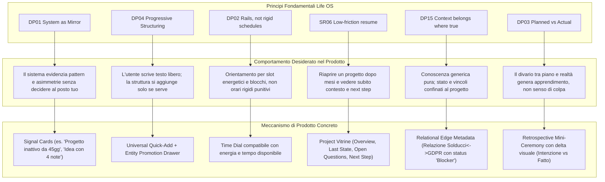
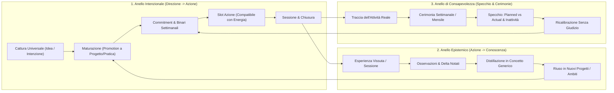
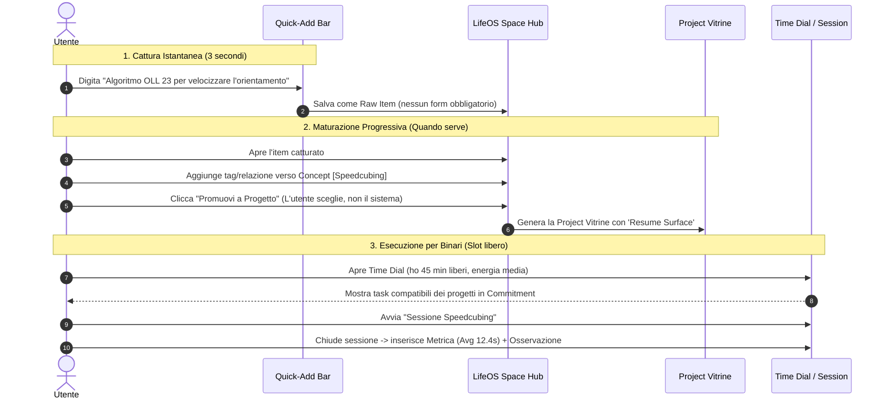
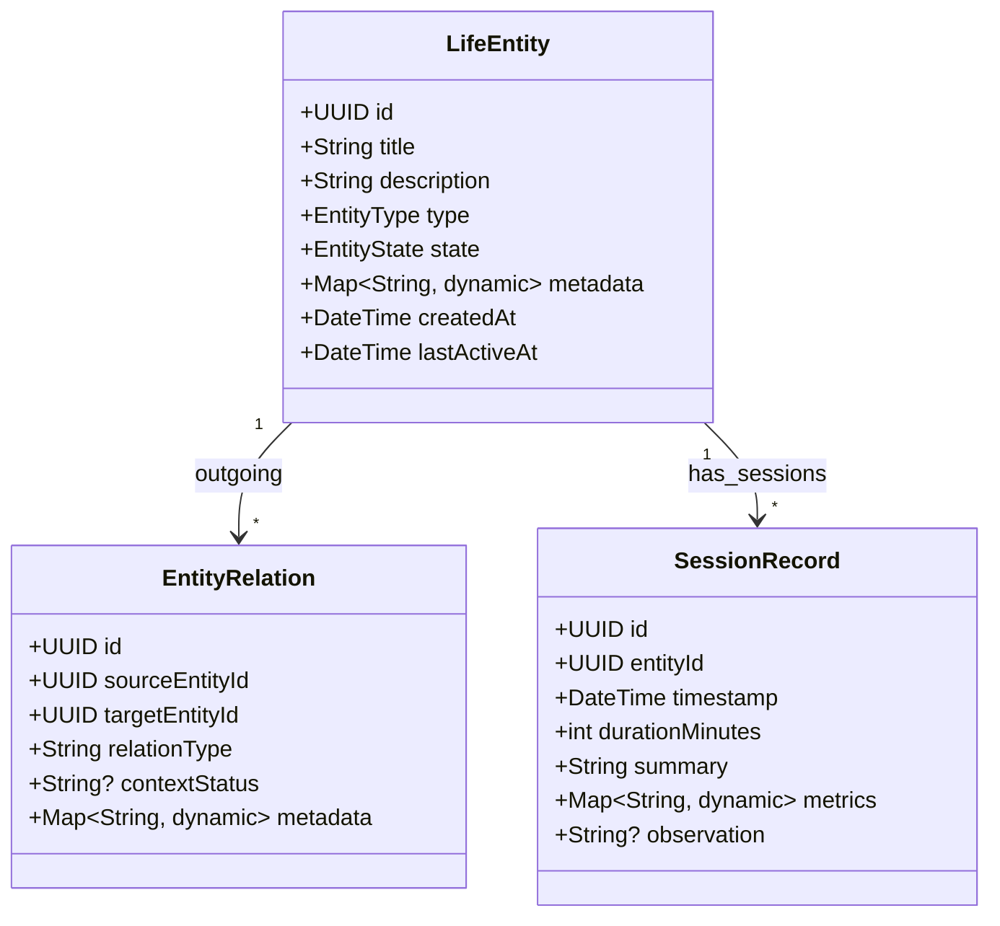
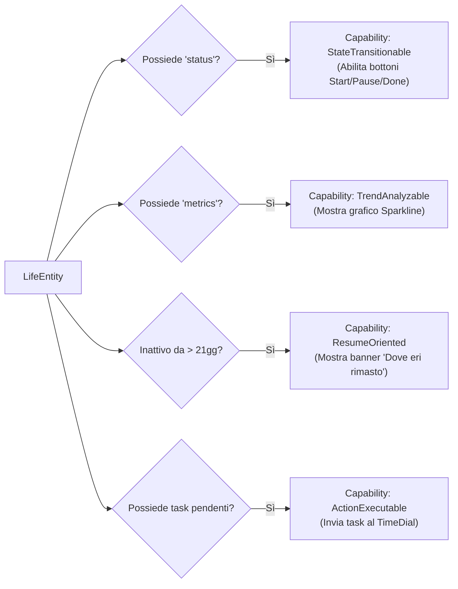
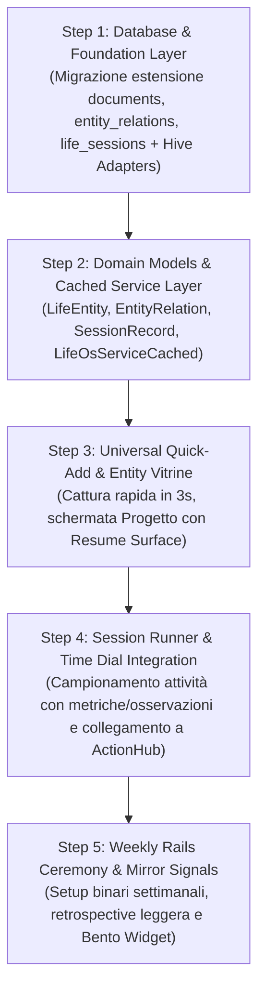

# Integration Exploration v0.1 — Concretizzare il Cuore di Life OS in Solducci

> **Data:** 24 Ottobre 2026  
> **Autore:** Antigravity (Pair Programming con l'Autore)  
> **Contesto:** Progetto Solducci — Branch / Worktree `LIFE_OS`  
> **Fonti Canoniche:** Checkpoint `Life OS v0.1` (`idealization/markdown/` 00–12) & Architettura Reale Solducci (`lib/`, `supabase/migrations/`)

---

## 1. Understanding: Quale problema stiamo realmente risolvendo?

### 1.1 La natura del problema
Non stiamo costruendo un "ennesimo modulo" all'interno di un'app di finanza condivisa, né stiamo programmando un clone locale di Notion, Obsidian o Todoist.

Il problema che questa concretizzazione deve risolvere è squisitamente esistenziale ed operativo:
> **La mente umana possiede una memoria di lavoro ristretta e volatile, ma una vita ricca è per definizione multidirezionale.**
> Quando una persona coltiva simultaneamente ingegneria software, visione imprenditoriale, pratiche fisiche e cognitive (speedcubing, musica, uncinetto), studio teorico, gestione domestica e relazioni, il prezzo pagato nei sistemi ordinari è la **frammentazione cognitiva, l'evaporazione delle idee o l'ipertrofia burocratica**.

### 1.2 Perché Solducci è la "Prima Casa"
Solducci ha già sviluppato nel suo codice i recettori biologici di Life OS:
- Ha già scoperto la necessità di passare dalle sole spese all'**Azione** (`TimeScenario`, `Routine`, `TimeDial`).
- Ha già sentito il bisogno dello **Spazio** (`Document`, `note_items`, `asterisk_items`, `resource_items`, `infinite_canvas`).
- Ha già compreso l'importanza della modularità con il **Bento Dashboard** a incastro dinamico.
- Ha già blindato il perimetro dei dati col **ContextManager** e l'isolamento multi-tenant a livello di database.

Tuttavia, fino ad oggi questi moduli vivevano come "isole separate": una spesa era un'isola, un task era confinato dentro un documento ToDo, un appunto in una nota, un evento in uno scenario.
**L'obiettivo di Life OS dentro Solducci è fornire il tessuto connettivo vivente**: un ambiente in cui un'intuizione possa nascere leggera, collegarsi a ciò che già esiste, maturare senza imposizioni tassonomiche, guidare l'azione quotidiana senza trasformarsi in una prigione di scadenze e permettere di riprendere qualsiasi filo interrotto dopo settimane di assenza senza alcuno sforzo di ricostruzione mentale.

---

## 2. LifeOS → Product Translation

Come i principi cardinali di Life OS si traducono in comportamenti visibili del prodotto:



---

## 3. Core Loops: I Cicli Operativi del Prodotto

Affinché Life OS non sia una collezione statica di record, il prodotto deve abilitare e chiudere tre anelli di retroazione primari:



---

## 4. Candidate First Vertical Slices

Valutiamo 3 possibili configurazioni di prima concretizzazione:

| Dimensione | Slice A: "The Knowledge & Task Graph" | Slice B (Consigliata): "The Living Core (Vitrine + Session + Rail)" | Slice C: "The Ceremony & Reflection Hub" |
| :--- | :--- | :--- | :--- |
| **Cosa Include** | Grafo nodale generico, note markdown interconnesse, task polimorfici, edge semantici. | **Universal Capture**, **Entity Page (Project Vitrine)** con Resume Surface, **Session Log leggero**, **Weekly Rail (Binari)** con slot d'azione. | Wizard per Cerimonia Settimanale/Mensile, questionari retrospective, planned vs actual aggregato su DB esistente. |
| **Cosa Esclude** | Cerimonie, time dial dinamico, resume automatico, metriche di sessione. | Grafo visivo infinito a nodi complessi, AI agent, calcolo automatico ontologico universale. | Cattura progressiva di nuove entità, gestione flessibile del grafo, entità diverse da quelle attuali. |
| **Valore Immediato** | Alto per studio teorico; basso per l'azione e la vita quotidiana. | **Altissimo:** scarica la testa, azzera il costo di rientro dei progetti, connette tempo e azioni. | Medio: molto utile durante la domenica sera, ma inerte durante la settimana. |
| **Case Studies Coperti** | Solducci (parziale), Agrivoltaico (solo note). | **Solducci, Agrivoltaico, Speedcubing, Crochet (Tutti i 4 cardine).** | Solducci (macro), LaGenteStrana. |
| **Complessità Tecnica** | Alta (motore di grafo, layouting, nodi infiniti). | **Bilanciata:** estende `documents`, `tasks`, `time_scenarios` con contratti coerenti. | Bassa/Media (UI form driven e query analitiche). |
| **Rischio** | Cadere nel *Fallimento B* (meta-framework explosion). | Basso, orientato all'uso reale continuo. | Cadere nel *Fallimento A* (burocratizzazione senza operatività quotidiana). |

---

## 5. Recommended Slice: "The Living Core"

### Perché raccomandiamo la Slice B
Ottimizza il rapporto:
$$\text{Score} = \frac{\text{Valore Pratico} \times \text{Apprendimento dall'Uso} \times \text{Fedeltà Filosofica}}{\text{Complessità di Manutenzione}}$$

1. **Risolve la frizione più dolorosa:** il *costo di rientro* (`SR06`). Riaprire Solducci, Agrivoltaico o Speedcubing e vedere la **Project Vitrine** (Cos'è, Perché esiste, Ultimo stato, Domande aperte, Prossimo passo) produce sollievo immediato.
2. **Supporta sia l'intenzione che la pratica:** grazie all'entità leggera `Session`, permette a uno sviluppatore di tracciare una sessione di codice, a un cuber di registrare un summary di allenamento e a chi fa uncinetto di segnare l'avanzamento di un capo.
3. **Introduce i Binari (`Rails`) senza calendario prigione:** permette la domenica o il lunedì di selezionare 3-5 focus della settimana, rendendoli disponibili negli slot del `TimeDialWidget` già presente in Solducci.

---

## 6. Information Architecture della Sezione LifeOS

In Solducci, l'app navigation bar attuale (`ShellWithNav`) presenta 4 hub:
1. `BentoDashboardPage` (Feed)
2. `EconomyHubView` (Economia)
3. `ActionHubView` (Tempo & Azione)
4. `SpaceHomeView` (Spazio & Conoscenza)

### Architettura di Integrazione
Piuttosto che aggiungere un quinto tab estraneo che frammenterebbe la navigazione, **LifeOS si radica come l'Intelligenza Operativa che unifica Spazio e Azione, culminando nella "Project Vitrine" e nel "Weekly Rail"**:

```text
[ShellWithNav]
  ├── [Bento Feed] ──> Widget LifeOS: "Focus Settimanale", "Riprendi Progetto (Vitrine)", "Segnali Specchio"
  ├── [Economia]    ──> Tracciamento risorse materiali (immutato, ma linkabile a progetti)
  ├── [Azione]      ──> Esecuzione & Tempo:
  │                     ├── Time Dial (Rails & Slot energetici)
  │                     ├── Nuova: "Session Runner" (Campionamento esperienza)
  │                     └── Nuova: "Cerimonia Settimanale" (Planned vs Actual)
  └── [Spazio (LifeOS Hub)] ──> Cuore Ontologico & Conoscenza:
                        ├── 🚀 Universal Capture Bar (testo grezzo -> entità)
                        ├── 📌 Active Commitments & Vitrine (Solducci, Cubing, ecc.)
                        ├── 💡 Idea Incubator (Esplorazioni in macerazione)
                        ├── 🧠 Knowledge & Concepts (Distillazioni riutilizzabili)
                        └── 🗺️ Visual Canvas (Esploratore a grafo esistente)
```

---

## 7. Interaction Model: Flussi Utente Chiave



---

## 8. Existing Architecture Mapping

Mappatura dettagliata sulle classi e sui file reali della repository:

| Elemento LifeOS | Risorsa Esistente Solducci | Tipologia | Analisi Tecnica & Opportunità |
| :--- | :--- | :--- | :--- |
| **Polymorphic Container** | [documents table](file:///C:/Users/Aless/Documents/Projects/LIFE_OS/supabase/migrations/20241204_create_documents_tables.sql#L17-L38) | **Extension** | La tabella `documents` ha già `metadata JSONB` e `document_type`. Possiamo estendere `document_type` con `'project'`, `'concept'`, `'session'`. |
| **Tasks & Subtasks** | [tasks table](file:///C:/Users/Aless/Documents/Projects/LIFE_OS/supabase/migrations/20241204_create_documents_tables.sql#L61-L85)<br>[UnifiedTaskListBloc](file:///C:/Users/Aless/Documents/Projects/LIFE_OS/lib/blocs/unified_task_list/unified_task_list_bloc.dart) | **Reuse** | Il pattern Strategy `TaskListDataSource` è perfetto: può caricare task associati a qualsiasi documento/progetto. |
| **Context Scoping** | [ContextManager](file:///C:/Users/Aless/Documents/Projects/LIFE_OS/lib/service/context_manager.dart)<br>[DirectContextBound](file:///C:/Users/Aless/Documents/Projects/LIFE_OS/lib/core/context/context_bound.dart) | **Reuse** | LifeOS è un'entità contestuale (personale o collaborativa come *LaGenteStrana*). Il `ContextManager` gestisce già la visibilità. |
| **Time Dial & Scenari** | [TimeDialWidget](file:///C:/Users/Aless/Documents/Projects/LIFE_OS/lib/widgets/time_dial.dart)<br>[time_scenarios](file:///C:/Users/Aless/Documents/Projects/LIFE_OS/supabase/migrations/20260630_time_management_schema.sql#L18-L30) | **Extension** | `TimeDialWidget` oggi visualizza eventi fissi. Può diventare il selettore di slot per azioni compatibili con energia e durata (`SR14`). |
| **Offline Caching** | [PersistentCacheableService](file:///C:/Users/Aless/Documents/Projects/LIFE_OS/lib/core/cache/persistent/persistent_cacheable_service.dart)<br>Hive Boxes | **Reuse** | Avvio istantaneo a freddo (~150ms) e persistenza locale già garantiti per le nuove entità. |
| **Bento Widgets** | [BentoMosaicEngine](file:///C:/Users/Aless/Documents/Projects/LIFE_OS/lib/widgets/dashboard/bento_mosaic_engine.dart)<br>[BentoDashboardPage](file:///C:/Users/Aless/Documents/Projects/LIFE_OS/lib/views/bento_dashboard_page.dart) | **Opportunity** | Creazione immediata di un widget Bento `LifeOsFocusWidget` e `ProjectResumeCardWidget` nella home feed. |
| **Edge Semantici** | *Nessuno nel DB (esistono solo FK)* | **NEW** | Serve una tabella leggera `entity_relations` per collegare Entità tra loro con metadati di contesto (relevance, status, decision). |

---

## 9. Candidate Domain Model (Vertical Slice)

Per evitare l'esplosione ontologica, distinguiamo rigorosamente:



- **Necessario Subito (MVP Slice):**
  - `LifeEntity` (con subtype logico: `Idea`, `Project`, `Concept`, `Practice`).
  - `EntityRelation` (arco orientato: `source_id`, `target_id`, `relation_type`, `context_status`).
  - `SessionRecord` (campionamento dell'attività vissuta: durata, metriche libere in JSONB, osservazione qualitativa).
- **Working Hypothesis (Trattato con proprietà dinamiche, non tabelle rigide):**
  - `Milestone` e `Goal` vivono come task strutturati o metadata dentro l'entità Progetto.
  - `Observation` vive come campo all'interno della `Session` o nota allegata.
- **Volutamente Deferred:**
  - Tassonomia complessa di `Passion`, `SkillTree` con livelli RPG, `InspirationGraph` universale.

---

## 10. Storage & Evolution Strategy

```text
Decision: Come modellare la persistenza delle entità LifeOS in Supabase?
Context: Dobbiamo scegliere tra creare un grafo astratto universale (nodi/archi puri) o estendere la tabella 'documents' esistente.
Options:
  1. Tabella universale astratta 'nodes' e 'edges' (Graph Puro).
  2. Nuova gerarchia di tabelle dedicate ('projects', 'ideas', 'sessions', 'relations').
  3. Estensione pragmatica polimorfica di 'documents' + tabella 'entity_relations' e 'life_sessions'.
Trade-offs: L'opzione 1 è troppo astratta e rende le query/RLS complesse in Flutter. L'opzione 2 crea tabelle rigide e viola la strutturazione progressiva.
Recommendation: Opzione 3 (Estensione di 'documents' + tabelle mirate 'entity_relations' e 'life_sessions').
Confidence: Alta (9/10).
Revisit when: Se le entità LifeOS superano le 10.000 unità e richiedono un motore di inferenza grafi dedicato.
```

### Struttura Schema Postgres (Semplice ed Evolvibile)
1. **Estensione `documents`**:
   `document_type CHECK (document_type IN (..., 'life_project', 'life_concept', 'life_idea', 'life_practice'))`
   Tutto il contenuto libero o i dettagli specifici vivono nel già presente `metadata JSONB`.
2. **Tabella `entity_relations`**:
   `id`, `source_id` (FK documents), `target_id` (FK documents), `relation_type` (es. `requires`, `influences`, `part_of`, `context_for`), `context_status` (es. `blocker`, `active`, `resolved`), `metadata JSONB`.
3. **Tabella `life_sessions`**:
   `id`, `entity_id` (FK documents), `started_at`, `duration_minutes`, `activity_summary`, `metrics JSONB`, `observations TEXT`, `created_at`.

---

## 11. Capability Analysis: Schema → Capability → Operations

Invece di creare classi rigide nel codice Dart, adottiamo il principio **Capability-Driven**:



Nel codice Flutter, questo si traduce in **Extension Methods o Mixin leggeri su `Document`**:
```dart
extension LifeEntityCapabilities on Document {
  bool get isResumeWorthy => 
      updatedAt.isBefore(DateTime.now().subtract(const Duration(days: 21)));
  
  bool get hasActionableRails => 
      metadata['is_current_commitment'] == true;
}
```
Nessun framework astratto: semplice logica di business applicata ai metadati.

---

## 12. Views Strategy: Una Sola Realtà, Molte Proiezioni

La stessa istanza di `LifeEntity` (es. il progetto **Solducci** o **Speedcubing**) produce interfacce differenti in base al contesto:

1. **Resume Lens (Progetto dormiente riaperto):**  
   Nasconde l'elenco lungo dei task completati; evidenzia in alto:
   - *Perché esiste* (Visione iniziale).
   - *Ultima attività registrata* (Data e sintesi ultima sessione).
   - *Punti aperti / Bloccanti* (Open questions).
   - *Prossimo passo immediato*.
2. **Execution Lens (Modalità Sprint/Lavoro attivo):**  
   Mette in primo piano i task del giorno, il cronometro di sessione e i comandi rapidi.
3. **Exploration Lens (Modalità Agrivoltaico / Idea):**  
   Nasconde task ed estimazioni; enfatizza domande aperte, link a risorse di studio e scenari alternativi.

---

## 13. Ceremonies Strategy: Quale Introdurre per Prima?

```text
Decision: Quale cerimonia implementare nella prima vertical slice?
Context: I documenti definiscono 4 cerimonie (Annuale, Mensile, Settimanale, Daily).
Options:
  1. Annuale: Massima ampiezza, ma frequenza troppo bassa per imparare dall'uso immediato.
  2. Daily: Rischio di attrito e di sembrare un diario compilativo burocratico.
  3. Settimanale (Weekly Rails & Retrospective): Frequenza ideale (ogni 7 giorni), connette direttamente l'intenzione all'azione della settimana successiva.
Recommendation: Cerimonia Settimanale (Weekly Planning & Light Retrospective).
Confidence: Altissima (10/10).
Revisit when: Quando la cerimonia settimanale è utilizzata con fluidità per almeno 4 settimane consecutive.
```

### Il Flusso della Cerimonia Settimanale (10 minuti la domenica/lunedì)
1. **Step 1: Reality Check (Planned vs Actual):**  
   Il sistema mostra i binari della settimana passata e le sessioni registrate. Nessun punteggio rosso o allarme punitivo: solo evidenza visiva (*"Avevi previsto 3 sessioni su Solducci e ne hai fatta 1; hai fatto invece 4 ore di Speedcubing"*).
2. **Step 2: Scansione Specchio:**  
   Il sistema segnala: *"Agrivoltaico è fermo da 40 giorni. Vuoi lasciarlo parcheggiato o dargli spazio?"*
3. **Step 3: Selezione dei Binari (`Rails`) della Settimana:**  
   L'utente trascina 2–4 entità/progetti nella lista "Active Commitments".
4. **Step 4: Pronti per l'Azione:**  
   I binari selezionati popolano automaticamente i suggerimenti del `TimeDialWidget` per tutta la settimana.

---

## 14. Signals Strategy: Specchio Semplice Subito, AI Dopo

Nella prima slice implementiamo **3 soli segnali puramente deterministici** (calcolati a costo zero in memoria):
1. **Segnale Inattività Silente (`InactivitySignal`):**  
   `Entità in Commitment == true` MA `nessuna sessione/task negli ultimi 14 giorni` $\rightarrow$ *"Questo progetto è in commitment ma non riceve attenzione da 2 settimane. Ricalibriamo?"*
2. **Segnale Maturazione Idea (`MaturitySignal`):**  
   Un'`Idea` che ha accumulato $>3$ note e almeno una risorsa/tag $\rightarrow$ *"Questa idea ha accumulato molto contenuto. Desideri promuoverla a Progetto?"*
3. **Segnale Debito di Distillazione (`DistillationDebtSignal`):**  
   Più di 5 risorse/link salvati in uno spazio senza alcuna nota o sessione di sintesi $\rightarrow$ *"Hai accumulato riferimenti senza distillazione"*.

Tutti i segnali sono presentati come **suggerimenti non invasivi** (chip dismissibili). Nessuna automazione distruttiva o non richiesta.

---

## 15. Resume Strategy: Azzerare l'Attrito di Rientro

Come funziona la **Resume Surface** di un'entità dopo un periodo di inattività:

```text
┌─────────────────────────────────────────────────────────────┐
│ 🚀 PROGETTO: SOLDUCCI                               [Attivo] │
│ Inattivo da 34 giorni                                       │
├─────────────────────────────────────────────────────────────┤
│ 💡 MENTAL ANCHOR (Perché esiste)                             │
│ "Piattaforma di risorse condivise e primo vascello Life OS" │
│                                                             │
│ 📍 DOVE TI ERI FERMATO (Ultima Sessione - 18 Settembre)     │
│ "Implementato isolamento RLS e caricamento immagini gruppo"  │
│                                                             │
│ ❓ DOMANDE APERTE / BLOCCHI AL MOMENTO DELLA PAUSA          │
│ • Valutare se integrare la tabella entity_relations          │
│ • Testare avatar picker su dispositivo fisico               │
│                                                             │
│ ▶️ PROSSIMO PASSO CONSIGLIATO                               │
│ [ ] Eseguire migrazione 001_life_os_core_schema             │
│                                                             │
│ [ Riprendi Lavoro (Avvia Sessione) ]   [ Mantieni in Pausa ] │
└─────────────────────────────────────────────────────────────┘
```
Queste informazioni **non richiedono campi complessi aggiuntivi**: vengono estratte deterministicamente leggendo l'ultima `SessionRecord` e il primo task non completato.

---

## 16. Technical Roadmap a Piccoli Passi Verticali

Procederemo secondo il metodo iterativo indicato:



Ogni step si conclude con un'applicazione compilabile, testata e funzionante su dispositivo/emulatore.

---

## 17. Analisi dei Rischi

| Tipologia di Rischio | Descrizione | Strategia di Mitigazione Adottata |
| :--- | :--- | :--- |
| **UX Friction Risk** | Dover compilare troppi campi durante la cattura fa abbandonare l'app. | **Universal Quick-Add a 1 campo:** basta un titolo/testo; tutto il resto è facoltativo e differibile. |
| **Overengineering Risk** | Costruire un motore di grafi generico che richiede mesi senza dare utilità. | Usare `documents` come tabella cardine; archi semantici gestiti da una tabella snella `entity_relations`. |
| **Burocratizzazione** | Le cerimonie diventano lunghe e noiose. | Cerimonia settimanale progettata come un flusso guidato da **massimo 5-10 minuti**, con dati pre-compilati dallo specchio. |
| **Calendar Prison** | Sentirsi in colpa se non si rispettano gli orari. | Nessuna programmazione ad orari fissi; solo **allocazione per binari** (`Rails`) e slot compatibili con l'energia. |
| **Under-modeling Risk** | Modello troppo povero che non distingue un'Idea da un Progetto. | Tipizzazione semantica leggera tramite `document_type` e `metadata['status']`, preservando la distinzione concettuale. |

---

## 18. Open Questions

### A. Blocking (Da allineare prima del codice di Step 1)
1. **Posizionamento Visivo del Quick-Add:** Lo colleghiamo al `ConstellationMenu` esistente del tasto FAB centrale in `ShellWithNav`, oppure creiamo un punto di cattura rapido sempre visibile in cima allo `SpaceHomeView`?
   - *Raccomandazione:* Entrambi: aggiunta rapida nel FAB + input espandibile in cima a Spazio.

### B. Can Learn by Building (Verificabili sul campo durante l'uso)
1. *Quali metriche specifiche sono più naturali per lo speedcubing o il codice?* (Il campo flessibile `metadata JSONB` dentro `SessionRecord` ci permette di scoprirlo usandolo).
2. *Quanto spesso un'Idea viene promossa a Progetto?* (I segnali dello specchio ci mostreranno il rateo reale di conversione).

### C. Deferred (Rimandate consapevolmente a fasi successive)
1. Riconoscimento automatico del testo tramite LLM/AI.
2. Sincronizzazione automatica bidirezionale con cstimer o GitHub commit history.

---

## 19. Proposed Artifacts da Mantenere nel Repository

Suggeriamo di conservare e versionare nel worktree:
1. `docs/life_os/INTEGRATION_EXPLORATION_V0_1.md` (Questo documento strategico).
2. `docs/life_os/DECISION_REGISTER.md` (Registro decisionale incrementale).
3. `docs/life_os/SCHEMA_DESIGN.md` (Specifiche tecniche SQL e TypeAdapters Hive).

---

## 20. Recommended Next Action

> **Azione Consigliata:**  
> Se sei allineato con la direzione di questa **Integration Exploration v0.1** (in particolare sulla raccomandazione della **Slice B: The Living Core** basata su Vitrine, Session e Weekly Rails), il passo concreto successivo è:
> 
> **Predisporre la migrazione Supabase e i contratti Dart dello Step 1 (Database & Foundation Layer)**, estendendo la tabella `documents` e creando `entity_relations` e `life_sessions` con il relativo supporto offline Hive.
