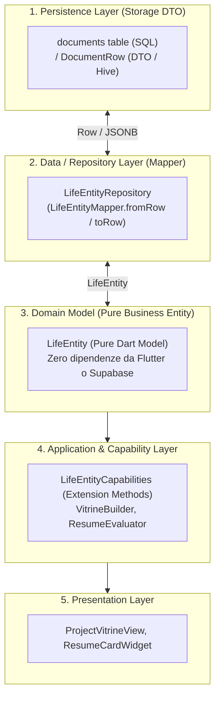
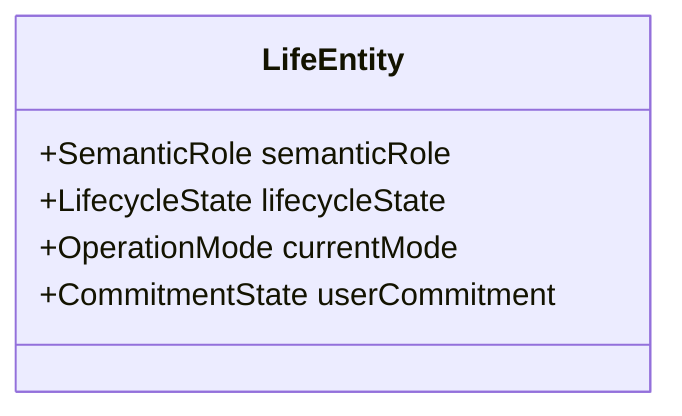
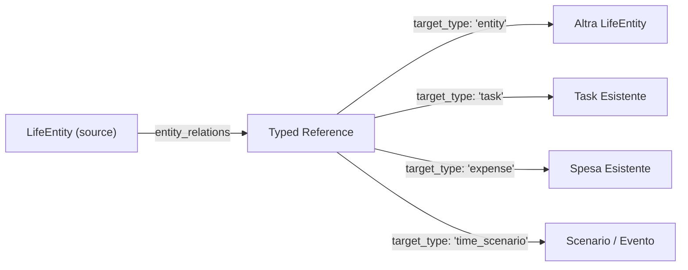

# Integration Foundation Gate v0.1 — Chiusura Definitiva dei Contratti Architetturali

> **Data:** 24 Ottobre 2026  
> **Autore:** Antigravity (Pair Programming con l'Autore)  
> **Contesto:** Progetto Solducci — Branch / Worktree `LIFE_OS`  
> **Scopo:** Risoluzione rigorosa degli ultimi 10 nodi architetturali e strutturali prima di procedere all'implementazione dello Step 1.

---

## 1. Eliminazione del Leakage `Document` dal Domain Model

Nel *Design Challenge v0.1* avevamo correttamente separato dominio e storage, ma l'interfaccia Dart di `LifeEntity` conteneva ancora un riferimento interno a `Document`. Risolviamo definitivamente questa contraddizione stabilendo una separazione a 4 livelli:



### Il Contratto Minimo Dart di Dominio
```dart
/// Pure Domain Model — Nessuna eredità o dipendenza da Document
class LifeEntity {
  final String id;
  final String? userId;
  final String? groupId;
  final String title;
  final String? description;
  final String semanticRole;    // 'seed', 'idea', 'project', 'practice', 'concept'
  final String lifecycleState;   // 'active', 'paused', 'completed', 'archived'
  final String currentMode;      // 'exploration', 'execution', 'practice', 'reflection'
  final DateTime createdAt;
  final DateTime updatedAt;
  final DateTime? lastMeaningfulActivityAt; // Derived cache
  final Map<String, dynamic> customMetadata;

  const LifeEntity({
    required this.id,
    this.userId,
    this.groupId,
    required this.title,
    this.description,
    this.semanticRole = 'seed',
    this.lifecycleState = 'active',
    this.currentMode = 'exploration',
    required this.createdAt,
    required this.updatedAt,
    this.lastMeaningfulActivityAt,
    this.customMetadata = const {},
  });

  bool get isPersonal => groupId == null;
  bool get isGroupShared => groupId != null;
}
```

---

## 2. Shared Entity vs Personal Overlay

Un'entità LifeOS in Solducci può essere strettamente personale (`groupId == null`) o condivisa con altri utenti tramite un contesto di Gruppo (`groupId != null`).

### Classificazione Rigorosa delle Dimensioni

| Dimensione | Classificazione | Motivazione | Dove Risiede nello Storage |
| :--- | :--- | :--- | :--- |
| **Semantic Role** | `ENTITY-INTRINSIC` | Solducci è un "Project" per tutti i membri; Speedcubing è una "Practice". | `metadata['semantic_role']` dell'entità |
| **Lifecycle State** | `ENTITY-INTRINSIC` | Se un progetto è 'completed' o 'archived', lo è per il progetto stesso. | `metadata['lifecycle_state']` dell'entità |
| **Current Mode** | `CONTEXTUAL RELATION` | Un progetto può essere in 'exploration' o 'execution' a livello di team. | `metadata['current_mode']` dell'entità |
| **Commitment** | `USER-SPECIFIC` | L'utente A decide di dedicarci 10 ore; l'utente B non ha commitment questa settimana. | **Personal Overlay** |
| **Weekly Rail** | `USER-SPECIFIC` | L'utente A mette il progetto nei propri binari settimanali; l'utente B ha altri binari. | **Personal Overlay** |
| **Priority** | `USER-SPECIFIC` | L'urgenza soggettiva differisce tra persone. | **Personal Overlay** |
| **Signal Snooze** | `USER-SPECIFIC` | L'utente A silenzia l'avviso di inattività; l'utente B desidera vederlo. | **Personal Overlay** |
| **Interest / Resonance** | `USER-SPECIFIC` | La risonanza valoriale appartiene alla coscienza del singolo individuo. | **Personal Overlay** |
| **Last Meaningful Activity** | `DERIVED` | Calcolato dal timestamp più recente delle sessioni o dei task. | **Derived Cache** (su entità) |
| **Resume State** | `DERIVED` | Sintesi calcolata da: ultima sessione, punti aperti e prossimi task. | **Runtime Projection** |
| **Personal Observations**| `USER-SPECIFIC` | Note soggettive e vissuto emotivo registrati durante le sessioni. | `life_sessions.observations` (owner: user) |

### Soluzione per la Differenza tra Utenti sullo Stesso Progetto
> *Domanda: Se due utenti condividono un Project ma uno vuole concentrarcisi questa settimana e l'altro no, dove vive questa differenza?*

**Risposta di Minimum Commitment:**  
Non creiamo una mastodontica tabella `user_entity_everything`.
Creiamo una tabella snella di **Overlay Personale** che memorizza solo le preferenze soggettive dell'utente autenticato:

```sql
CREATE TABLE IF NOT EXISTS user_entity_overlays (
  user_id UUID NOT NULL REFERENCES auth.users(id) ON DELETE CASCADE,
  entity_id UUID NOT NULL, -- Punta a documents(id)
  is_in_weekly_rail BOOLEAN NOT NULL DEFAULT FALSE,
  commitment_weight TEXT, -- 'high', 'medium', 'low', null
  snoozed_signals JSONB DEFAULT '{}'::jsonb, -- { "inactivity": "2026-11-01" }
  updated_at TIMESTAMPTZ DEFAULT now(),
  PRIMARY KEY (user_id, entity_id)
);

CREATE INDEX IF NOT EXISTS idx_user_entity_overlays_lookup 
  ON user_entity_overlays(user_id, is_in_weekly_rail);
```
- Se l'entità è personale, l'overlay è opzionale (può stare nei metadati diretti).
- Se l'entità è di gruppo, l'overlay permette a ciascun utente di avere i propri binari settimanali (`is_in_weekly_rail`) senza interferire con i binari degli altri membri.

---

## 3. Separazione delle 4 Dimensioni Semantiche

Non appiattiamo stati eterogenei su un singolo campo. Le quattro dimensioni sono ortogonali:



1. **Semantic Role (`semantic_role`):**  
   Cosa rappresenta ontologicamente: `'seed'`, `'idea'`, `'project'`, `'practice'`, `'concept'`.  
   *Regola:* Cambia solo con promozione o declassamento deliberato.
2. **Lifecycle State (`lifecycle_state`):**  
   Stadio evolutivo: `'active'`, `'paused'`, `'completed'`, `'archived'`.  
   *Regola:* Archiviare un Progetto imposta `lifecycle_state = 'archived'`; **non** lo trasforma in un'Idea.
3. **Current Mode (`current_mode`):**  
   Lente operativa corrente: `'exploration'`, `'execution'`, `'practice'`, `'reflection'`.  
   *Regola:* Un Progetto può entrare temporaneamente in modalità `'exploration'` per sciogliere un'incertezza senza perdere la sua natura di Progetto.
4. **Commitment (`is_in_weekly_rail` / `commitment_weight`):**  
   Scelta deliberata di allocare energia nel periodo corrente (gestita tramite l'Overlay Personale).

---

## 4. Session Relationships: Confronto Tecnico

Confermiamo l'UX: **1 Contesto Primario Obbligatorio + N Contesti Secondari Facoltativi**.  
Confrontiamo le due implementazioni di persistenza:

| Criterio | Opzione A: `related_entity_ids UUID[]` | Opzione B: `life_session_relations` (Tabella Junction) |
| :--- | :--- | :--- |
| **Integrità Referenziale** | Nessuna FK automatica sull'array. Richiede trigger o pulizia applicativa su delete. | **Completa:** FK con `ON DELETE CASCADE` gestita nativamente dal motore relazionale. |
| **RLS (Access Control)** | Semplice: la sessione ha `user_id`, policy diretta. | Complessa: richiede subquery RLS per autorizzare la riga di giunzione. |
| **Query Inverse** (*Sessioni legate all'entità X*) | `WHERE primary_entity_id = X OR X = ANY(related_entity_ids)`. Molto veloce con indice GIN. | `WHERE primary_entity_id = X` UNION `JOIN life_session_relations`. Richiede join relazionale. |
| **Modello Offline Hive** | **Trivialmente compatto:** Un unico oggetto `LifeSession` con `List<String> relatedEntityIds`. | Complesso: richiede sincronizzare e salvare due box Hive separati per ogni sessione. |
| **Metadati Futuri sulla Relazione** | Limitati (solo lista di ID). | Possibili (es. tempo esatto speso sul sottotask). |
| **Complessità di Manutenzione** | **Minima (1 sola tabella, zero join).** | Media/Alta (2 tabelle, transazioni doppie). |

### Decisione: Opzione A (`UUID[]` con Indice GIN)
Per la prima concretizzazione (Living Core), l'Opzione A vince nettamente per semplicità, compatibilità con la cache Hive e velocità di query.  
```sql
CREATE TABLE IF NOT EXISTS life_sessions (
  id UUID PRIMARY KEY DEFAULT gen_random_uuid(),
  user_id UUID NOT NULL REFERENCES auth.users(id) ON DELETE CASCADE,
  primary_entity_id UUID NOT NULL REFERENCES documents(id) ON DELETE CASCADE,
  related_entity_ids UUID[] DEFAULT '{}',
  started_at TIMESTAMPTZ NOT NULL DEFAULT now(),
  duration_minutes INTEGER NOT NULL CHECK (duration_minutes >= 0),
  activity_summary TEXT NOT NULL,
  metrics JSONB DEFAULT '{}'::jsonb,
  observations TEXT,
  created_at TIMESTAMPTZ DEFAULT now()
);

CREATE INDEX IF NOT EXISTS idx_life_sessions_primary ON life_sessions(primary_entity_id);
CREATE INDEX IF NOT EXISTS idx_life_sessions_related ON life_sessions USING GIN(related_entity_ids);
```

---

## 5. Relazioni Tipizzate/Polimorfiche & Integrità dei Dati

La tabella `entity_relations` adotta il pattern **Typed Reference** (`target_type`, `target_id`) per connettere LifeEntity a qualsiasi oggetto Solducci:



### Disciplina dell'Integrità Referenziale
1. **Validazione all'inserimento:**  
   L'application service valida che il target esista interrogando il repository corrispondente (`TaskRepository`, `ExpenseRepository`).
2. **Prevenzione Dangling References (Eliminazione a cascata):**  
   Aggiungiamo un trigger PostgreSQL snello per gestire la cancellazione dei target:
   ```sql
   CREATE OR REPLACE FUNCTION cleanup_entity_relations_target()
   RETURNS TRIGGER AS $$
   BEGIN
     DELETE FROM entity_relations WHERE target_id = OLD.id;
     RETURN OLD;
   END;
   $$ LANGUAGE plpgsql;

   -- Trigger su tasks, expenses, time_scenarios
   CREATE TRIGGER trg_cleanup_task_relations AFTER DELETE ON tasks
   FOR EACH ROW EXECUTE FUNCTION cleanup_entity_relations_target();
   ```
3. **Risoluzione a runtime (Application Resolver):**  
   Un servizio singleton `TypedReferenceResolver` risolve a runtime la coppia `(target_type, target_id)` restituendo un DTO compatto per la UI:
   `ResolvedReference(title, subtitle, icon, statusColor, route)`.

---

## 6. Meaningful Activity: Derived State con Materializzazione Protetta

- **Source of Truth Canonica:** I record immutabili degli eventi vissuti (`life_sessions.started_at`, `tasks.completed_at`).
- **Problema di Performance:** Calcolare `MAX(sessions, tasks)` ad ogni build di ogni card in una lista di 40 progetti produce un collo di bottiglia evitabile.
- **Strategia di Materializzazione Protetta:**
  1. `metadata['last_meaningful_activity_at']` è una **Derived Cache**, MAI l'unica fonte di verità.
  2. Viene aggiornato optimisticamente dal repository quando viene salvata una `LifeSession` o completato un `Task`.
  3. **Auto-healing:** Se il campo è nullo o in caso di dubbio, il repository esegue una funzione `recalculateMeaningfulActivity(entityId)` che interroga le fonti canoniche e riallinea il timestamp.

---

## 7. Raw Capture: Il Concetto di `seed`

Quick Capture deve ottimizzare: **"Capture now, understand later"**.  
Un input rapido come `"Studiare F2L"` o `"Comprare filo di rame"` nel momento in cui viene digitato **non deve essere forzato** ad essere un'Idea, né un Progetto, né una Pratica.

```text
[Universal Quick-Add Bar]
"Studiare F2L" ────> Inserimento istantaneo (zero form)
                     ├── semantic_role: 'seed'
                     ├── lifecycle_state: 'active'
                     └── current_mode: 'exploration'
```
- Il ruolo predefinito è `'seed'` (seme grezzo).
- I seed appaiono in cima allo Spazio LifeOS in un cassetto disordinabile e leggero (*"Catture Recenti"*).
- Solo durante la Cerimonia Settimanale o quando l'utente lo desidera, il seed viene promosso:
  - Cliccando *"Diventa Progetto"* $\rightarrow$ `semantic_role = 'project'`.
  - Cliccando *"Diventa Pratica"* $\rightarrow$ `semantic_role = 'practice'`.
  - Cliccando *"Diventa Nota/Concetto"* $\rightarrow$ `semantic_role = 'concept'`.

---

## 8. Semantica Reale del Layer Offline

La verifica approfondita del codice in [`persistent_cacheable_service.dart`](file:///C:/Users/Aless/Documents/Projects/LIFE_OS/lib/core/cache/persistent/persistent_cacheable_service.dart#L180-L200) ha fatto emergere la verità empirica:
- L'app supporta un **eccellente Instant Cold Boot da disco Hive (~150ms)** e **letture offline senza latenza**.
- Le scritture con `create(item)` invocano `super.create(item)` direttamente su Supabase e **falliscono in assenza di connessione**, poiché non esiste una coda transazionale offline con CRDT o risoluzione automatica dei conflitti.
- **Conseguenza Immediata per LifeOS:**  
  Non pretendiamo garanzie che l'infrastruttura non possiede. Il layer LifeOS nello Step 1 sarà:
  > **Offline-Readable con Avvio Istantaneo (Hive) + Scrittura Ottimistica con Fallback.**  
  Se la rete non è disponibile durante la cattura, mostriamo feedback chiaro all'utente invece di simulare una sincronizzazione in background inesistente.

---

## 9. Metadata Discipline: Regole di Archiviazione

Per evitare che `metadata JSONB` diventi un agglomerato ingestibile, definiamo una disciplina rigorosa con classi Dart tipizzate:

```dart
class LifeEntityMetadata {
  final Map<String, dynamic> _raw;

  LifeEntityMetadata(this._raw);

  String get semanticRole => _raw['semantic_role'] as String? ?? 'seed';
  String get lifecycleState => _raw['lifecycle_state'] as String? ?? 'active';
  String get currentMode => _raw['current_mode'] as String? ?? 'exploration';
  DateTime? get lastMeaningfulActivityAt => _raw['last_meaningful_activity_at'] != null 
      ? DateTime.tryParse(_raw['last_meaningful_activity_at']) 
      : null;

  Map<String, dynamic> toMap() => Map.unmodifiable(_raw);
}
```

- **Colonne SQL Esplicite:** Identificativi, proprietà strutturali stabili (`id`, `user_id`, `group_id`, `title`, `description`, `created_at`, `updated_at`).
- **Metadata JSONB Tipizzato:** Dimensioni semantiche evolutive (`semantic_role`, `lifecycle_state`, `current_mode`, `last_meaningful_activity_at`).
- **Tabelle Dedicate:** Relazioni polimorfiche (`entity_relations`), Sessioni temporali (`life_sessions`) e Overlay soggettivi multiutente (`user_entity_overlays`).

---

## 10. Final Foundation Decision & Step 1 Implementation Specification

### Matrice delle Decisioni Finali

| Decisione | Status | Persistenza Subito? | Motivazione Architetturale | Reversibile? |
| :--- | :--- | :---: | :--- | :--- |
| **D1: Disaccoppiamento LifeEntity / Document** | Established | **Sì** | Elimina leakage; permette a LifeEntity di essere modello puro. | Altamente reversibile (Repository pattern) |
| **D2: Ruoli semantici con default 'seed'** | Established | **Sì** | Rispetta la strutturazione progressiva (`DP04`). | Totale (stringa in metadata) |
| **D3: Separazione 4 dimensioni (Role/State/Mode/Commit)** | Established | **Sì** | Evita di confondere l'archiviazione con la tipizzazione. | Totale |
| **D4: Sessioni con `UUID[]` per related entities** | Established | **Sì** | Semplicità assoluta, zero join, perfetta per Hive. | Migrabile a junction table se necessario |
| **D5: Relazioni TypedReference con trigger di pulizia** | Established | **Sì** | Connette Task, Spese e Scenari senza orfani. | Tabella isolata, altamente espandibile |
| **D6: Tabella Overlay per Utente (`user_entity_overlays`)** | Established | **Sì** | Risolve il problema del commitment personale su progetti condivisi. | Tabella indipendente |
| **D7: Meaningful activity come Derived Cache** | Established | **Sì** | Performance istantanea sulla dashboard con auto-healing dalle sessioni. | Ricostruibile in ogni momento |

---

## Conclusione del Gate: 🟢 **FOUNDATION READY**

Tutti i punti di attrito, di leakage o di ambiguità sono stati formalmente risolti. Possiamo procedere con piena fiducia alla codifica dello **Step 1**.

---

## Step 1 Implementation Specification (Pronta per il Codice)

### A. Migrazioni Database Supabase (File SQL)
Nome: `supabase/migrations/20261025_create_life_os_core_schema.sql`
1. Estensione del vincolo `documents_document_type_check` per includere `'life_entity'`.
2. Creazione della tabella `entity_relations` con indici B-Tree su `(source_id, source_type)` e `(target_id, target_type)`.
3. Creazione della tabella `life_sessions` con indice B-Tree su `primary_entity_id` e indice GIN su `related_entity_ids`.
4. Creazione della tabella `user_entity_overlays` con chiave primaria composta `(user_id, entity_id)`.
5. Trigger di pulizia per la cancellazione a cascata dei target polimorfici da `tasks` ed `expenses`.
6. Policy Row-Level Security (RLS) basate su `auth.uid()` e permessi di gruppo.

### B. Contratti e Modelli di Dominio Dart
1. `LifeEntity`: Modello puro di dominio in `lib/features/life_os/domain/models/life_entity.dart`.
2. `LifeSession`: Modello puro in `lib/features/life_os/domain/models/life_session.dart`.
3. `EntityRelation`: Modello puro in `lib/features/life_os/domain/models/entity_relation.dart`.
4. `UserEntityOverlay`: Modello per le preferenze soggettive in `lib/features/life_os/domain/models/user_entity_overlay.dart`.

### C. Data Layer & Mappers
1. `LifeEntityMapper`: Conversione bidirezionale tra `Document` (DTO/Row) e `LifeEntity`.
2. `LifeEntityRepository`: Interfaccia e implementazione Supabase + fallback Hive.
3. `LifeSessionRepository`: CRUD e query di aggregazione temporale per le sessioni.

### D. Ordine Rigoroso di Esecuzione
1. Creazione e verifica della migrazione SQL in `supabase/migrations/`.
2. Scrittura dei modelli di dominio e dei TypeAdapter Hive.
3. Scrittura del repository layer e dei test unitari di mapping e derivazione.
4. Registrazione in `lib/core/di/service_locator.dart`.
