# LifeOS Depth Surfacing Design v0.1: From Note-Taking to an Experienced Continuity System

**Date:** 2026-10-25 (Updated in Step 3.2a)  
**Context:** Solducci LifeOS — Step 3.2a Strategic Design Correction  
**Originating Feedback:** User Observed Requirement — *"LifeOS currently feels mostly like a somewhat more evolved note-taking system; its deeper power is not yet evident."*

---

## 1. Executive Diagnosis: Why Does LifeOS Risk Feeling Like "Just Notes"?

Currently, LifeOS provides:
1. Universal Capture of text seeds into a list.
2. A Vitrine view with inline editable title, description, custom properties, and sequential thought blocks.
3. Bento projections of recent seeds, active entities, and pinned tiles.

To a user interacting purely with text boxes and cards, this can easily look structurally indistinguishable from Apple Notes, Bear, or Notion with tags.

The profound difference between a **notes app** and a **Life Operating System** does not lie in richer typography, nested folders, or artificial intelligence summaries. It lies in **four closed behavioral and relational continuity loops**:
- A notes app is a **passive repository** where text accumulates and decays into an unorganized attic.
- LifeOS is a **living substrate** that actively assists human re-entry, maintains relational context across operational domains (tasks, documents, finances, time), and reflects lived reality back to the human without requiring administrative gardening.

---

## 2. Analysis of the Four Foundational Loops

```mermaid
flowchart TD
    subgraph LoopA["Loop A: Capture / Return / Structure"]
        A1["Raw Thought"] --> A2["Resting Seed"]
        A2 --> A3["Returned Attention"]
        A3 --> A4["Progressive Structure (Role / Packs)"]
    end

    subgraph LoopB["Loop B: Connection / Context Recovery"]
        B1["Entity"] <--> B2["Entity / Task / Document / Time"]
        B2 --> B3["Recovered Context"]
        B3 --> B4["Zero Reconstruction Cost"]
    end

    subgraph LoopC["Loop C: Continuity / Resume"]
        C1["Entity Focus"] --> C2["Lived Activity / Session"]
        C2 --> C3["Trace & Bookmark ('Where was I?')"]
        C3 --> C4["Inactivity & Return"]
        C4 --> C5["Instant Contextual Resume"]
    end

    subgraph LoopD["Loop D: Intention / Actual / Mirror"]
        D1["Weekly Intention (Weekly Rails)"] --> D2["Observed Actual Allocation"]
        D2 --> D3["Mirror Reflection"]
        D3 --> D4["Periodic Review / Ceremony (Human Recalibration)"]
    end
```



---

### Loop A — Capture / Return / Structure
> *How raw, transient mental sparks mature into ongoing life realities without upfront cognitive tax.*

```text
thought → Seed → returned attention → progressive structure
```

1. **Human Problem Solved:** The paradox of capture: when an idea occurs, any requirement to categorize it (choose project, tags, deadlines, priority) kills the impulse; but uncategorized captures become a graveyard that is never revisited.
2. **Mechanism:**
   - Universal Capture saves a raw thought as a Seed with zero required categorization.
   - The Seed rests in the Living Core and is surfaced on Bento (`RecentSeedsWidget`).
   - When attention naturally returns, the human opens the Vitrine and progressively assigns a Nature (Progetto, Pratica, Concetto, Idea), which introduces tailored Role Property suggestions without imposing rigid schemas.
3. **Internal Sub-loop (Entity Evolution):**
   - Once structured, the Entity evolves organically by appending sequential living blocks (`EntityBlock`) and non-destructive progressive properties (`EntityProperty`).

---

### Loop B — Connection / Context Recovery
> *How an Entity serves as the gravitational center for tasks, resources, and temporal constraints without duplicate entry or fragmented mental reconstruction.*

```text
Entity ↔ Entity ↔ Task ↔ Resource / Document ↔ Time / Session → recovered context
```

1. **Central Phenomenological Question:**
   > *"Quando torno su qualcosa dopo giorni o mesi, quali connessioni riducono il lavoro mentale necessario a ricostruire 'che cosa significava tutto questo'?"*
2. **Human Problem Solved:** The high cognitive friction of context fragmentation. When working on an endeavor (e.g. "Ristrutturazione Casa", "Certificazione Cloud", "Nuovo Prodotto"):
   - Tasks live in a todo list.
   - Financial allocations live in Solducci expenses.
   - Reference notes live in documents/markdown.
   - Dedicated time blocks live on the calendar.
   When the user returns after a lapse of time, they face severe mental fatigue trying to assemble the puzzle: *"Qual era il blocker? Che spesa avevamo autorizzato? Dove sono gli appunti dell'architetto?"*
3. **The Relational Web (`EntityRelation`):**
   - The Entity is the gravitational center that links polymorphically to:
     - **Entity ↔ Entity:** Parent/child or peer initiatives (e.g., Sub-projects or interrelated Concepts).
     - **Entity ↔ Task:** Tactical execution steps, highlighting blockers (`context_status = blocker`).
     - **Entity ↔ Resource / Document:** Canonical reference materials, contracts, or guides.
     - **Entity ↔ Time / Session:** Time allocations on the Time Dial and recorded execution sessions.
4. **Context Recovery in the Vitrine:**
   - The Vitrine does not force the user to navigate across 4 different app sections. It projects an immediate **"Costellazione Collegata"**:
     - `[ 2 Task attivi • 1 Blocker ]` $\rightarrow$ tap reveals the blocker in place.
     - `[ 3 Documenti di riferimento ]` $\rightarrow$ direct preview without losing place.
     - `[ Budget dedicato / Spese collegate ]` $\rightarrow$ instant financial context.
5. **Reconstruction Cost:** Drops from 15 minutes of app-hopping and mental re-indexing to 10 seconds of glanceable relational orientation.

---

### Loop C — Continuity / Resume
> *How a human can leave an endeavor for 3 weeks, return, and resume immediately without re-entry paralysis.*

```text
Entity → activity/session → trace/bookmark → inactivity → return → resume
```

1. **Human Problem Solved:** The "Re-entry Paralysis". When life forces a pause on a project, returning produces guilt and cognitive overload because working memory has decayed: *"Dove ero rimasto? Qual era il filo conduttore? Da dove ricomincio?"*.
2. **Mechanism:**
   - **Session Runner:** An unobtrusive in-place or floating tracker on the Entity (`"Inizia sessione"`).
   - **The Stopping Trace / Bookmark:** Upon stopping, prompts for a single, low-friction observation: *"Dove ti sei fermato? Qual è il primo gesto alla ripresa?"*.
   - **The Resume Surface:** When opening an Entity after an inactivity lapse, a prominent top banner immediately restores the human's mental context:
     > *"Ultima sessione (12 ott): 'Mappata retention policy. Prossimo step: verificare con DPO' [ Riprendi da qui ]"*
3. **Continuity vs Note-Taking:** A note is static text. A Continuity Bookmark is an active beacon left by the past self to guide the future self back into flow.

---

### Loop D — Intention / Actual / Mirror
> *How a human compares intentional life priorities with lived reality through periodic calm recalibration.*

```text
weekly intention → actual activity → observed allocation → Mirror → human recalibration
```

1. **Human Problem Solved:** The illusion of time and focus allocation. Humans intend to dedicate energy to high-value endeavors (creative writing, health practices, strategic projects), but days vanish into drift and reactive noise.
2. **Mechanism:**
   - **Weekly Intention:** The human designates a small set of primary focus entities for the cycle via the Weekly Rail (`UserEntityOverlay.isInWeeklyRail = true`).
   - **Observed Actual Activity:** Sessions and task completions are silently aggregated per Entity and Nature.
   - **The Mirror (Lo Specchio):** A calm, non-judgmental reflective view displaying the delta between intended allocation and actual reality.
   - **Periodic Review / Ceremony (Weekly Ceremony):**
     - **Cadence Principle:** Ceremony cadence is an organic domain capability (e.g. weekly or periodic review).
     - **Policy Principle:** Specific calendar days (e.g. Sunday evening or Monday morning) are user-configurable policies, NOT hard-coded domain invariants.
     - Provides a calm space to celebrate lived progress, release stale intentions, and reset the Weekly Rail for the next cycle.

---

## 3. Strategic Assessment for Step 4

### The Strategic Rule: One Complete Closed Loop Over Four Fragmented Features
Implementing isolated pieces (a raw timer here, an unconnected relation there, a fixed ceremony modal) produces fragmented UI clutter. The next step must deliver **one complete, experiential loop**.

### Candidate Analysis
- **Loop B (Connection):** Very high structural value. However, without active sessions, connections risk feeling like a manual relational database that requires data-entry discipline.
- **Loop C (Continuity):** High emotional and operational impact. Immediately transforms an Entity into an active work surface, solves re-entry anxiety, and naturally generates the activity stream required by Loop B and Loop D.

> **Status:** Step 4 remains **STRICTLY FROZEN**. No implementation of Loop B, C, or D is authorized until physical device validation of Step 3.2 / 3.2a is complete and reviewed.
