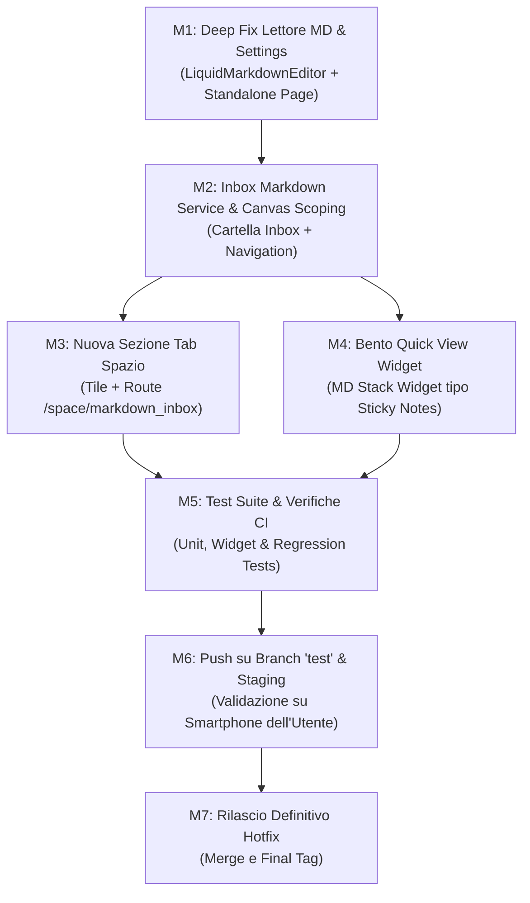

# 07 — Implementation Roadmap & Execution Plan

## 1. Worktree & Git Strategy

In accordo con le direttive fornite dall'utente e il protocollo di rilascio di Solducci:
1. **Creazione Worktree Isolato**:
   - Worktree path: `.worktrees/hotfix-md-reader`
   - Branch: `hotfix/v1.03.02-md-reader-inbox` originato da `HEAD` di `new_design`.
2. **Ciclo di Implementazione e Test**:
   - Esecuzione isolata nel builder.
   - Esecuzione suite di test automatizzati (Flutter test e unit test su controller/parser).
3. **Staging su Branch `test` per Validazione Fisica**:
   - Push del branch sul remote: `git push origin hotfix/v1.03.02-md-reader-inbox:test` (o allineamento del branch `test`).
   - Notifica all'utente per compilazione/installazione APK sul proprio smartphone fisico.
   - **Gate Umano di Chiusura**: Sospensione in attesa dell'approvazione formale dell'utente.
4. **Merge & Rilascio**:
   - Dopo conferma positiva dell'utente, merge su `new_design` / `release/` e completamento procedura di hotfix.

---

## 2. Milestones & Task DAG

### Dettaglio delle Fasi:

#### Fase 1: Deep Fix Lettore Markdown & Impostazioni
- [ ] Modificare `lib/widgets/liquid_markdown_editor.dart` per introdurre il parametro `isExpanded` (default `true` per standalone) ed eliminare la dipendenza stretta da `widget.limit > 0`.
- [ ] Creare `lib/service/markdown_settings_service.dart` per memorizzare preferenze utente (dimensione testo, apertura predefinita, blocco sola lettura).
- [ ] Creare `lib/widgets/markdown_viewer_settings_sheet.dart` con controlli interattivi.
- [ ] Aggiornare `lib/views/standalone_markdown_page.dart` integrando il pulsante impostazioni nella AppBar e passando i valori salvati.

#### Fase 2: Servizio Inbox Markdown & Scoping Nodi
- [ ] Estendere o coordinare `lib/service/recent_markdown_service.dart` con `lib/features/space/repositories/canvas_local_repository.dart` per garantire che ogni file aperto o importato venga inserito in una cartella `Inbox File MD`.
- [ ] Garantire la sincronizzazione multi-user/contesto per i nodi inbox.

#### Fase 3: Sezione "File Markdown" nella Tab Spazio
- [ ] Aggiornare `lib/features/space/views/space_home_view.dart` aggiungendo la tile "File Markdown".
- [ ] Creare `lib/features/space/views/markdown_inbox_canvas_view.dart` riutilizzando l'infrastruttura di `InfiniteCanvasView` pre-ancorata alla cartella Inbox.
- [ ] Aggiungere la route `/space/markdown_inbox` in `lib/routes/app_router.dart`.

#### Fase 4: Bento Widget "MD Quick Stack" (Gemello di Sticky Notes)
- [ ] Creare `lib/widgets/dashboard/widgets/markdown_stack_widget.dart` implementando il medesimo pattern gestuale/3D di `NoteStackWidget`.
- [ ] Registrare il widget in `bento_widget_config_registry.dart`, `dashboard_widget_factory.dart`, `bento_widget_preview_factory.dart` e `widget_gallery_sheet.dart`.

#### Fase 5: Verifica, Test e Staging
- [ ] Creare test unitari e di widget per validare il rendering del Markdown body con `limit == 0` e `defaultExpanded == true`.
- [ ] Eseguire `flutter test` nell'ambiente isolato.
- [ ] Push sul branch remoto `test` e attesa del feedback utente dal dispositivo fisico.
