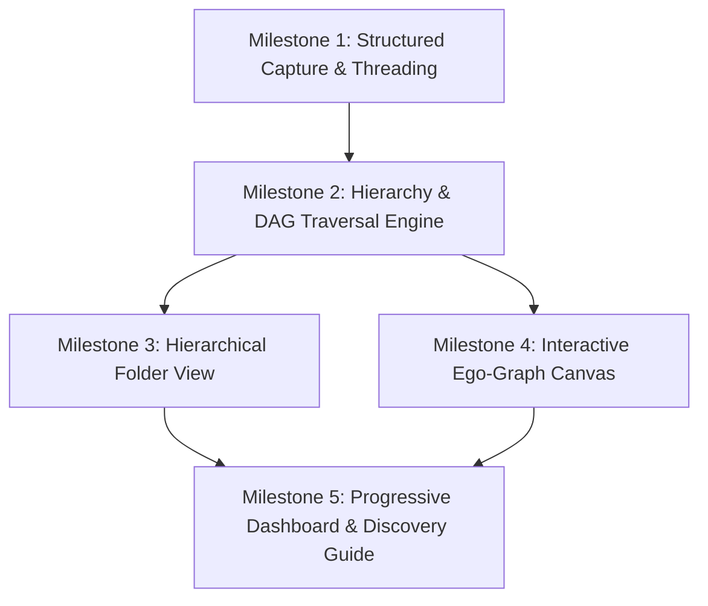

# 07 — IMPLEMENTATION ROADMAP & TEST PLAN

**Run ID:** `run_20261031_211008_project_graph_and_progressive_dashboard`  
**Git Branch:** `release/v1.06.01`  
**Execution Mode Target:** BUILDER READY (Structured, Incremental, Non-Breaking)  

---

## 1. Implementation Milestones & Work Packages

---

### Milestone 1: Universal Capture Long-Press & Threading Foundation
**Goal:** Empower users to initiate structured projects and contextual threads without leaving their capture flow.
1. **WP 1.1:** Add long-press gesture handling on the send button in `UniversalCaptureBar` and `LifeOsCaptureWidget`.
2. **WP 1.2:** Build `StructuredCaptureSheet` with pre-filled title, role selector, inline sub-idea chip adder, and one-tap creation transaction.
3. **WP 1.3:** Enhance entity bottom composer to support direct contextual thread continuation (`thread-seguito`).
4. **Deliverables & Files:**
   - `lib/features/life_os/presentation/widgets/structured_capture_sheet.dart`
   - Updates to `universal_capture_bar.dart` and `life_os_capture_widget.dart`
   - Unit & widget tests for long-press trigger and chip list manipulation.

---

### Milestone 2: Project Hierarchy & DAG Traversal Engine
**Goal:** Build client-side graph traversal, recursive tree resolution, and cycle prevention.
1. **WP 2.1:** Implement `ProjectHierarchyService`:
   - `Future<List<ProjectHierarchyNode>> buildHierarchyTree(String rootProjectId)`
   - `Future<List<LifeEntity>> getRecursiveDescendants(String rootProjectId)`
   - `Future<bool> wouldCreateCycle({required String childId, required String parentId})`
2. **WP 2.2:** Batch query optimizations in `EntityRelationRepository` to load project edges in a single query.
3. **Deliverables & Files:**
   - `lib/features/life_os/data/project_hierarchy_service.dart`
   - `test/features/life_os/project_hierarchy_service_test.dart` (Cycle detection tests, deep tree resolution tests).

---

### Milestone 3: Hierarchical Folder View (`ProjectFolderView`)
**Goal:** Clean, collapsible multi-level directory projection for projects.
1. **WP 3.1:** Implement `ProjectFolderView` with animated expand/collapse chevrons and hierarchical indentation.
2. **WP 3.2:** Add inline item creation ("+ Aggiungi elemento in questa cartella") and item inspection preview.
3. **WP 3.3:** Wire drag-and-drop or parent-picker to re-parent items cleanly.
4. **Deliverables & Files:**
   - `lib/features/life_os/presentation/widgets/project_folder_view.dart`
   - `test/features/life_os/project_folder_view_test.dart`.

---

### Milestone 4: Interactive Focused Ego-Graph View (`ProjectGraphView`)
**Goal:** Render a high-performance, clutter-free graph with exact gestural level descent.
1. **WP 4.1:** Develop `EgoGraphLayoutEngine` calculating radial coordinates for immediate children and cluster pills for ancestors/siblings.
2. **WP 4.2:** Build `EgoGraphPainter` (`CustomPainter`) rendering anti-aliased nodes, orbital rings, connection edges, and Nature color markers.
3. **WP 4.3:** Implement gesture discrimination:
   - Single tap: displays `NodeInspectionCard` at bottom.
   - Double tap: triggers camera transition and descends into tapped node as new focal center.
   - Swipe: horizontal gesture across node triggers level transit.
4. **WP 4.4:** Breadcrumb header navigation allowing instant one-tap return to any ancestor.
5. **Deliverables & Files:**
   - `lib/features/life_os/presentation/widgets/graph/ego_graph_painter.dart`
   - `lib/features/life_os/presentation/widgets/graph/project_graph_view.dart`
   - `lib/features/life_os/presentation/widgets/graph/node_inspection_card.dart`
   - Widget and gesture tests.

---

### Milestone 5: Progressive Dashboard Assembly & Pedagogical Discovery Sheet
**Goal:** Assemble dynamic dashboard modules based on project complexity and provide built-in onboarding guide.
1. **WP 5.1:** Implement `ProjectScopeContext.evaluateModules()` detecting data density.
2. **WP 5.2:** Build `ProjectDashboardView` dynamically mounting modules: Hero, Thread Stream, Folder Preview, Graph Radar, Task Horizon, Financial Scope.
3. **WP 5.3:** Build `ProjectDiscoverySheet` explaining root containers, folder vs graph utility, and gesture cheat-sheet.
4. **WP 5.4:** Integrate segmented view switcher (`Panoramica` | `Cartelle` | `Grafo`) into `EntityDetailScreen` for `SemanticRole.project`.
5. **Deliverables & Files:**
   - `lib/features/life_os/presentation/widgets/project_dashboard_view.dart`
   - `lib/features/life_os/presentation/widgets/project_discovery_sheet.dart`
   - Updates to `entity_detail_screen.dart`
   - Full end-to-end integration tests.

---

## 2. Test Verification Matrix

| Test Suite | File | Target Scenarios | Verification Gate |
| :--- | :--- | :--- | :--- |
| **DAG Cycle Prevention Test** | `test/features/life_os/project_hierarchy_service_test.dart` | Self-loop, 2-node cycle, 4-node transitive cycle, disconnected subgraphs | Pass 100% |
| **Hierarchy Tree Resolution Test** | `test/features/life_os/project_hierarchy_service_test.dart` | Depth 1 to 5, multi-branching, empty project | Pass 100% |
| **Capture Long-Press Test** | `test/features/life_os/universal_capture_bar_test.dart` | 400ms hold opens sheet, normal tap submits seed | Pass 100% |
| **Structured Sheet Submission Test** | `test/features/life_os/structured_capture_sheet_test.dart` | Multiple child items, batch relation creation | Pass 100% |
| **Folder View Widget Test** | `test/features/life_os/project_folder_view_test.dart` | Expand/collapse animations, level indentation | Pass 100% |
| **Graph Gesture Test** | `test/features/life_os/project_graph_view_test.dart` | Single tap selects, double tap descends, swipe drills down | Pass 100% |
| **Progressive Dashboard Test** | `test/features/life_os/project_dashboard_view_test.dart` | Nascent project has 2 modules, deep project has 6 modules | Pass 100% |

---

## 3. Zero-Regression Checklist

- [ ] All 46 existing LifeOS tests remain green.
- [ ] No database schema changes (`0` new SQL migrations).
- [ ] Universal Capture Bar single tap behavior is completely unaltered for standard seed capture.
- [ ] Offline local caching and sync continue to operate identically.
- [ ] Existing `LifeEntityMapper` and `documents.metadata['life_os']` structure are preserved.
