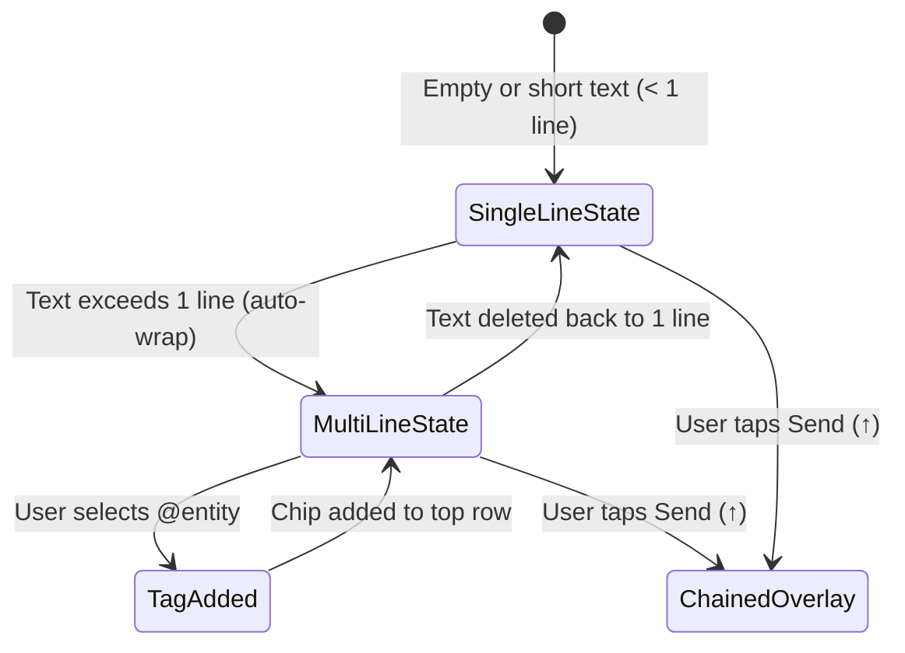

# 03 — PRODUCT BEHAVIOR SPECIFICATION

**Run ID:** `run_20261123_045201_dynamic_capture_bar_and_chained_seed_overlay`  
**Feature:** Dynamic Morphing Capture Bar, Chained Seed Overlay & Mention-Driven Graph Linking  

---

## 1. User Journey 1: Writing Short vs. Long Thoughts (Spatial Morphing)

### Flow 1.1: Single-Line State (Nascent Input)
- **Visual Presentation:**
  - A compact pill (height ~52px) with 14px padding.
  - Left: Leaf icon (`Icons.eco_outlined` or `Icons.all_inclusive_rounded`, `size: 20`).
  - Center: Single-line `TextField` with placeholder *"Cattura un pensiero, seme o @entità..."*.
  - Right: Circular primary button with arrow upward icon (`Icons.arrow_upward_rounded`).
- **Interaction:**
  - User types a short title: "Comprare cavo HDMI".
  - Text fits in one line; layout remains strictly horizontal.

### Flow 1.2: Multi-Line State Transition (Expanding Thought)
- **Trigger:**
  - The text exceeds the available width of the middle container, forcing a wrap to line 2, OR user explicitly types a newline (`\n`).
- **Animated Transition (Duration: 280ms, Curve: `Curves.easeOutCubic`):**
  1. **TextField Relocation:** The `TextField` smoothly shifts from the horizontal center of row 1 down into a dedicated **Row 2**.
  2. **Full-Width Stretch:** In Row 2, the `TextField` takes 100% of the container width (gaining the space previously occupied by the left icon and the right send button).
  3. **Row 1 Repurposing:**
     - Left: Leading icon remains anchored at the top-left.
     - Center: Dedicated space for Tag Chips (if any mentions exist).
     - Right: A text badge `"Raccogli seme "` slides in from the right (emerging from behind the send button) and locks into position immediately to the left of the arrow button.
  4. **Vertical Growth:** The container height grows smoothly as lines are added, up to a maximum height (e.g. 5-6 lines before internal scroll engages).

---

## 2. User Journey 2: The "@" Mention Receptor & Semantic Linking

### Flow 2.1: Mention Detection & Picker Overlay
- **Trigger:**
  - When the user types `@` (preceded by a space or start of line), an active suggestion overlay / autocomplete popover appears floating immediately above the capture bar.
- **Content of Suggestion Overlay:**
  - Filters entities from `LifeOsCenterCubit.state` (or active workspace) matching characters typed after `@`.
  - Shows icon/badge of semantic role (Progetto, Seme, Concetto, Pratica) and title.
- **Selection & Tag Creation:**
  - Tapping a suggestion inserts the tag into the capture bar.
  - The `@query` in the raw text is cleanly replaced or linked, and a visual **Tag Chip** is created.

### Flow 2.2: Automated Default Relation Heuristic
- **Rule A (Leading Tag):**
  - If `@Entity` is tagged at the *very start* of the input (e.g. `@Progetto Alfa Preparare scaletta`), the system automatically assigns the connection type:
    $$\text{Relation Type} = \text{"Figlio di"} \ (\texttt{RelationType.partOf})$$
- **Rule B (Mid-Text Tag):**
  - If `@Entity` is tagged anywhere *in the middle or end* of the text (e.g. `Parlare con Marco di @Iniziativa Beta per i dettagli`), the system automatically assigns:
    $$\text{Relation Type} = \text{"Semplice"} \ (\texttt{RelationType.relatesTo})$$

### Flow 2.3: Interactive Tag Chip & Popover Switcher
- In multi-line state, tags are rendered in the top-row tray as elegant chips:
  - Format: `[ ↳ @NomeProgetto ]` (for "Figlio di") or `[ ⚯ @NomeEntità ]` (for "Semplice").
- **Tapping the Chip:**
  - Opens a dedicated modal sheet / popover card:
    - **Header:** Title and role of the linked entity.
    - **Current Relation Badge:** "Relazione: Figlio di" vs "Relazione: Connessione Semplice".
    - **Interactive Switch / Segmented Control:**
      - Left: `Figlio di (partOf)` — *"Questo seme appartiene a questa entità"*.
      - Right: `Semplice (relatesTo)` — *"Questo seme è correlato a questa entità"*.
    - **Action:** "Rimuovi tag" button.
  - Switching toggles the chip icon and updates the planned relation metadata instantaneously.

---

## 3. User Journey 3: New Send UX & Chained Seed Overlay ("Raccogli una catena di semi")

### Flow 3.1: Triggering the Overlay
- **Action:** User taps the send button (or hits Enter on single-line).
- **Behavior:**
  1. **Modal Background Scrim:** The rest of the screen (header, list of seeds, app bar) dims with an animated dark scrim (`Color(0xCC09090B)`, 80% opacity), placing the previous view into an out-of-focus background.
  2. **Transformation to "Box Definitivo":**
     - The input container that held the newly submitted thought morphs into a static, elegant "Committed Seed Card" (dark surface with subtle border, tags displayed at the top, full text displayed).
     - The Send button (arrow) is replaced by an **"Edit"** button (pencil icon / *"Modifica"*), allowing the user to unfreeze and adjust the text if a typo was noticed.
  3. **Chained Collection Header:**
     - A subtle separator with the label appears:
       $$\text{"Raccogli una catena di semi"}$$
       accompanied by a small link chain icon (`Icons.link_rounded`).
  4. **Active Second-Tier Input Bar:**
     - Directly beneath the separator, a brand-new active capture bar fades in with autofocus.
     - Any seed submitted in this second bar is automatically linked to the first seed as a connected chain node:
       - `sourceId: newChildSeed.id`
       - `targetId: previousSeed.id`
       - `relationType: RelationType.partOf` (or `relatesTo`)
       - `metadata: {'chain_root_id': rootSeed.id, 'chain_depth': 1}`

### Flow 3.2: Continuing or Finalizing the Chain
- The user can type a 2nd, 3rd, or 4th connected thought in rapid succession.
- Each submitted link stacks cleanly in the committed stream above the active input.
- **Dismissal / Finalization:**
  - Tapping outside the sheet, tapping a "Concludi" / "Fatto" button at the top-right, or pressing the back button dismisses the overlay.
  - The scrim fades out, the primary list in `LifeOsCenterView` refreshes, and the newly created chain of seeds appears immediately in `RecentSeedsSection` with their relationship badges.

---

## 4. Edge Cases & Acceptance Criteria

1. **Empty Input Guard:** Tapping send when the text field contains only whitespace does nothing (no overlay, no network call).
2. **Rapid Deletion:** Fast backspacing from 3 lines back to 1 line smoothly reverses the layout animation without flickering or text jump.
3. **Multiple Mentions:** A user may tag multiple entities (e.g. `@ProgettoA e anche @ConcettoB`). Each appears as an independent chip in the top row. The first mention determines the primary hierarchy; subsequent mentions default to simple relations.
4. **Offline Resilience:** If connection is offline, the optimistic state commits locally; relations and seeds are saved with pending sync markers.
5. **Soft Keyboard Inset:** In the chained overlay, the active input bar remains pinned directly above the software keyboard (`MediaQuery.viewInsetsOf(context).bottom`).
