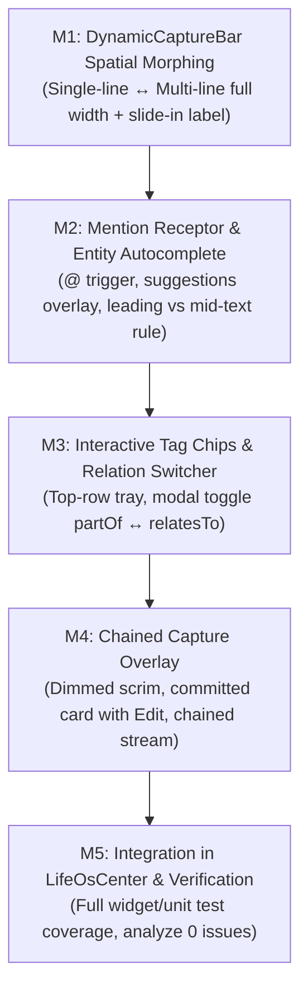

# 07 — IMPLEMENTATION ROADMAP & TEST STRATEGY

**Run ID:** `run_20261123_045201_dynamic_capture_bar_and_chained_seed_overlay`  
**Execution Target:** Phased Vertical Slices (M1 through M5)  

---

## 1. Milestones Breakdown

### Milestone 1: DynamicCaptureBar Spatial Morphing
- **Components:**
  - Create `lib/features/life_os/presentation/widgets/dynamic_capture_bar.dart`.
  - Implement line-count detection using `TextPainter` or line calculation.
  - Implement `AnimatedContainer` and `SlideTransition` for the slide-in text `"Raccogli seme "` emerging from behind the send button.
  - Ensure zero horizontal constraints on Row 2 so multiline text takes 100% width.
- **Verification:** Widget test verifying layout transition when typing single vs multi-line text.

### Milestone 2: Mention Receptor & Entity Autocomplete
- **Components:**
  - Implement `MentionTextController` and suggestion overlay `EntityMentionPicker`.
  - Query active entities from `LifeEntityRepository` / `LifeOsCenterCubit`.
  - Implement position-based default rule:
    - Index 0 $\rightarrow$ `RelationType.partOf` ("Figlio di").
    - Index > 0 $\rightarrow$ `RelationType.relatesTo` ("Semplice").
- **Verification:** Unit test for mention token parsing and relation defaulting.

### Milestone 3: Interactive Tag Chips & Relation Switcher
- **Components:**
  - Implement `SeedMentionChip` in the top row of the multiline capture bar.
  - Implement `SeedRelationSwitcherSheet` (modal bottom sheet or dialog) to toggle between `partOf` and `relatesTo`.
- **Verification:** Widget test simulating tap on tag chip, toggling relation switch, and asserting updated state.

### Milestone 4: Chained Capture Overlay
- **Components:**
  - Implement `ChainedCaptureOverlay` with dimmed scrim (`Colors.black87` / `Color(0xCC09090B)`).
  - Transform submitted seed into "Box Definitivo" card with `[ ✏️ Modifica ]` button.
  - Render separator label `"Raccogli una catena di semi"`.
  - Render secondary active `DynamicCaptureBar` anchored above keyboard.
  - Atomically commit seeds to `LifeEntityRepository` and links to `EntityRelationRepository`.
- **Verification:** Widget test verifying multi-seed chaining and database relation generation.

### Milestone 5: Full Integration & Regression Test Suite
- **Components:**
  - Update `LifeOsCenterView` to integrate `DynamicCaptureBar` and `ChainedCaptureOverlay`.
  - Run full analyzer: `flutter analyze lib/features/life_os/`.
  - Run full LifeOS test suite (75 existing tests + new capture/chaining tests).
