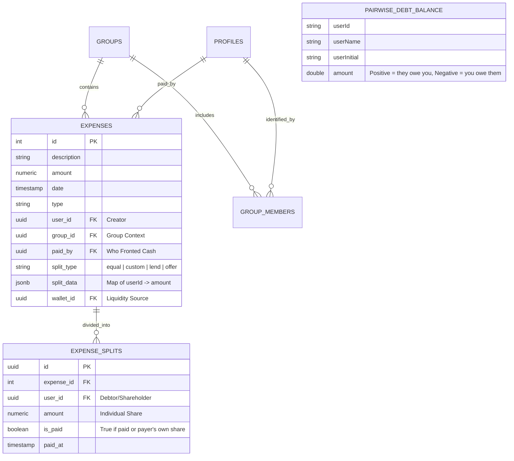

# 04 — DOMAIN AND DATA MODEL SPECIFICATION

**Run ID:** `run_20261124_194300_audit_debt_credit_calculation_chain`  
**Domain:** Solducci Financial Domain Entities & Database Mapping  

---

## 1. Domain Entities & Roles

---

## 2. Mathematical Definition of Balances

Given group $G$ with members $M$ and current user $U_{curr} \in M$:

For each group expense $E_k \in G$:
- Let $P_k = E_k.paid\_by \neq \text{null} \ ? \ E_k.paid\_by : E_k.user\_id$
- Let $S_k = \{ s \in \text{splits}(E_k) \mid \neg s.is\_paid \}$

### Pairwise Balance for peer $M_j \neq U_{curr}$:
$$
B(U_{curr}, M_j) = \sum_{E_k \mid P_k = U_{curr}} \left( \sum_{s \in S_k \mid s.user\_id = M_j} s.amount \right) - \sum_{E_k \mid P_k = M_j} \left( \sum_{s \in S_k \mid s.user\_id = U_{curr}} s.amount \right)
$$

### Semantics:
- $B(U_{curr}, M_j) > 0 \implies$ **Credit** ($M_j$ owes money to $U_{curr}$).
- $B(U_{curr}, M_j) < 0 \implies$ **Debt** ($U_{curr}$ owes money to $M_j$).
- $B(U_{curr}, M_j) = 0 \implies$ **Settled / Balanced**.

---

## 3. Required Data Normalization Fixes

1. **Defensive Field Access in Queries:**
   - Database column `paid_by` can be `null` in legacy entries.
   - Any Dart cast must use `(expense['paid_by'] as String?) ?? (expense['user_id'] as String?)`.
   - Never do direct non-nullable cast `expense['paid_by'] as String`.
2. **`split_data` Preservation in `SplitType.equal`:**
   - When a subset of members is chosen in equal split mode, `split_data` stores `{"user_A": 40.0, "user_B": 40.0}`.
   - Split generator must check `if (expense.splitData != null && expense.splitData!.isNotEmpty)` and generate splits exclusively for keys in `splitData`.
3. **Explicit Typing in In-Memory Models:**
   - `PairwiseDebtBalance.amount`: canonical source of truth for pairwise status.
   - `youOwe`: strictly `amount < -0.009`.
   - `theyOwe`: strictly `amount > 0.009`.
