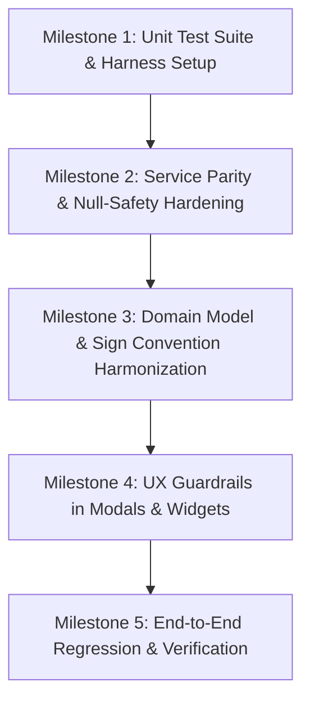

# 07 — IMPLEMENTATION ROADMAP

**Run ID:** `run_20261124_194300_audit_debt_credit_calculation_chain`  
**Strategy:** Zero-Downtime, Isolated Worktree Verification, Multi-Phase Rollout  
**Execution Mode:** SPEC_ONLY (Planning only; changes execute in approved build phase)  

---

## 1. Milestones & Work Breakdown

### Milestone 1: Unit Test Suite & Harness Setup
- **Goal:** Establish a baseline test harness for group balance calculation.
- **Tasks:**
  - Create `test/unit/debt_credit_calculation_chain_test.dart`.
  - Implement test cases covering:
    - 2-person group equal split (payer gains credit).
    - 2-person group equal split (peer pays, user owes).
    - 3-person group selective equal split (2 members selected).
    - Lend split (`SplitType.lend`).
    - Offer split (`SplitType.offer`).
    - Null `paid_by` defensive handling without crash.
- **Verification:** Unit tests run via `flutter test test/unit/debt_credit_calculation_chain_test.dart`.

### Milestone 2: Service Parity & Null-Safety Hardening
- **Goal:** Eliminate service divergence and the fatal null-cast runtime crash.
- **Tasks:**
  - Update `ExpenseServiceCached._calculateSplits` (`lib/service/expense_service_cached.dart:856-870`) to match `ExpenseService._calculateSplits` by supporting `expense.splitData` in `SplitType.equal`.
  - Null-harden `calculateGroupBalance` in both `lib/service/expense_service.dart:532` and `lib/service/expense_service_cached.dart:560`:
    Replace `final paidBy = expense['paid_by'] as String;` with  
    `final paidBy = (expense['paid_by'] as String?) ?? (expense['user_id'] as String?);`
    `if (paidBy == null) continue;`
- **Verification:** Passing all Milestone 1 unit tests.

### Milestone 3: Domain Model & Sign Harmonization
- **Goal:** Eliminate sign convention traps across `DebtBalance`, `PairwiseDebtBalance`, and `GroupedDebtBalance`.
- **Tasks:**
  - Add explicit docstrings and deprecation notices to inverted `DebtBalance.netBalance`.
  - Ensure all new and active widgets consume `PairwiseDebtBalance` where `amount > 0` consistently means credit.
  - In `BalancePillWidget`, resolve UUID to user nickname in group context.
- **Verification:** Dashboard widget tests and regression check.

### Milestone 4: UX Guardrails in Modals & Widgets
- **Goal:** Prevent accidental payer inversion by users.
- **Tasks:**
  - Update `UnifiedTransactionModal` payer selector with explicit visual title and dynamic credit impact preview.
  - Display explicit warning when a user marks another person as the payer.
- **Verification:** Manual and widget interaction tests.

### Milestone 5: End-to-End Regression & Release Readiness
- **Goal:** Ensure complete integrity across the build pipeline.
- **Tasks:**
  - Run full test suite: `flutter test`.
  - Run static analysis: `flutter analyze`.
  - Verify zero Git conflicts against `origin/test`.
